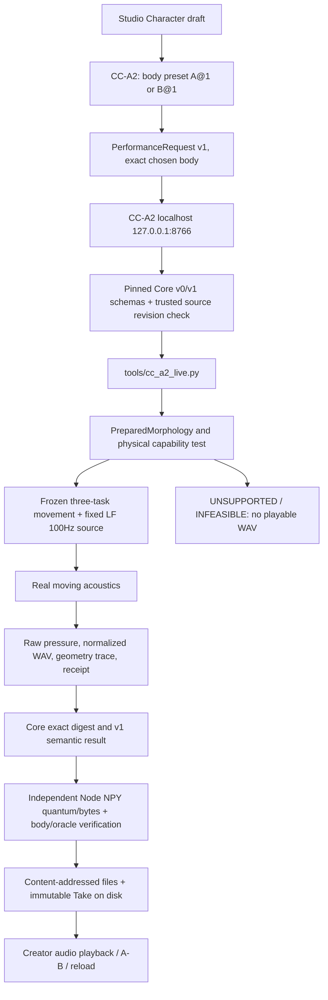

# CC-A2 — 2身体を交換して聴く（Studio Stage A、GO_LIMITED採用済み）

**Status: GO_LIMITED ADOPTED / MERGED on 2026-10-19.** [Studio PR #19](https://github.com/ryonakayama234/morphoacoustics-studio/pull/19) merge `5c787ff0a7e6ddd9826681d7dda6d081a5ce76e0`; [Core PR #122](https://github.com/ryonakayama234/morphoacoustics/pull/122) merge `2855aa75534be95c95133daf079c957823c82040`. Existing X2a remains unchanged; the separate Performance Contract **v1** localhost bridge is a bounded creative/research feature, not a universal anatomy editor. [Stage A acceptance Issue #14](https://github.com/ryonakayama234/morphoacoustics-studio/issues/14) is the canonical final gate receipt.

Parents: [Studio #14](https://github.com/ryonakayama234/morphoacoustics-studio/issues/14), [Core CC-A2 PR #122](https://github.com/ryonakayama234/morphoacoustics/pull/122), adopted Contract v1 [Core PR #101](https://github.com/ryonakayama234/morphoacoustics/pull/101).

## Creator scenario

1. Characterの名前・説明を通常のStudioで作る。
2. 下部のCC-A2 Stage Aパネルから16.0 cmの身体A (`v3b-axial-M0@1`) を選択しPerform。
3. 次に17.6 cmの身体B (`v3b-axial-M1@1`) でPerform。
4. 保存された2つのTakeをA/Bとして選択し、WAVを再生し、身体traceと物理計算receiptを参照する。
5. ブラウザ再読み込み・localhost再起動後も同じTakeを読み込む。

発話は単一の実験用「あい」だけです。音源F0=100 Hz、固定したtask-level Gesture、seed=0、0.5s 48kHz mono; 変更は声道の長さだけ。**自然な日本語、聴覚的な話者性、身体組織の実在的モデルは未検証です。**

## Current SYSTEM / DATA flow



### Trust and contract

- Core's v1 JSON schemas are read from an **exact SHA pinned checkout**, rather than redefining Studio schemas; v0 remains unmodified and separately supported.
- Core Python produces `sha256-canonical-json-v1`; Studio treats it as an opaque authority, never asserting JSON.stringify byte equivalence.
- A selection is exact preset ID/revision. Result must contain a matching resolved BOUND body/preparation digest. Historical Takes retain that snapshot, with no mutable/latest re-resolution.
- The limited bridge only listens on loopback, enforces a bounded request, a single worker, a fixed Python command, a 180-second worker timeout, and a source revision/dirty-worktree gate. This is a trusted local research tool, not a multi-tenant security sandbox.
- Studio independently quantizes the **actual** 24,000-sample NPY pressure bytes; A also matches frozen Experiment029 pressure checksum, and both match Core execution receipt. Changes in terminal resonances are checked against frozen Experiment028 Wolfram peaks; all errors refuse Take storage.
- WAV is peak-normalized separately. It is not calibrated SPL, and listening preferences are not scientific physics gates.
- Core outputs are rewritten into immutable server-local, content-addressed artifact refs only *after* verification. Both original Core result and transformed archived result are retained for audit.
- User interactions are versioned v1 Takes separate from adopted v0/X2a history; no mass migration, no free-text Direction-to-physics mapping, no post-hoc neural or EQ.

## WSL2/Linux local runbook

The CC-A2 Core is an **unmerged** feature branch. Use a separate pinned checkout from the existing frozen X2a Core tree (which must remain at `a75418770ed28cbd301d554171a6b60ee5a05ee9` for X2a). The CC-A2 trusted source check will not accept a different Core HEAD.

```bash
git clone https://github.com/ryonakayama234/morphoacoustics.git morphoacoustics-cc-a2
cd morphoacoustics-cc-a2
git fetch origin pull/122/head
git checkout b569f044bfda309dff1a00cccf8365754e6b1355
python3.11 -m venv .venv
source .venv/bin/activate
pip install 'numpy==2.4.6'
pip install -e '.[dev]'
cd ..

git clone https://github.com/ryonakayama234/morphoacoustics-studio.git
cd morphoacoustics-studio
git fetch origin feature/cc-a2-studio-two-body-20261019
git switch --detach FETCH_HEAD
npm install --global npm@11.6.0
npm install --no-audit --no-fund
export MORPHO_CORE_DIR="$(pwd)/../morphoacoustics-cc-a2"
export MORPHO_PYTHON="$MORPHO_CORE_DIR/.venv/bin/python"
npm run cc-a2:server
```

In a second WSL2 terminal, run `npm run dev` in the same Studio checkout, open the Vite URL, click **「CC-A2 · 2身体の比較実験を開く／閉じる」**, then use the Stage A panel. It is intentionally opt-in so original X2a runs without the new CC-A2 service. To exercise legacy X2a independently, run its separate existing service against its independently pinned older Core checkout.

**Do not use the Core feature branch as a replacement for the old X2a pinned source checkout.** After core PR changes, update the Studio exact SHA, both CI pin and this runbook before claiming new-head compliance.

## CI / review gates (historical plan; final acceptance below)

- Core's dedicated pinned Python test / frozen Experiment028 Wolfram and Experiment029 M0 quantized checks must PASS at exact Head.
- Studio `npm run build`, `npm test`, CC-A2 Node policy and Core-backed real HTTP E2E CI must PASS on exact pinned Core SHA.
- End-to-end: two fresh physical executions, raw NPY / WAV and immutable result, no counterfeit audio for missing body, reload/restart persistence.
- Browser automated flow and actual Windows/WSL2 human audition remain **separate human/UX gates** if not executed.
- Independent physics, contract/provenance and security reviews must examine exact HEADs. AI-only review must disclose independence limits.
- No merge/Ready before scoped GO_LIMITED decision after blocking checks. Unsupported is not acoustic INFEASIBLE; a process failure is FAILED.

## Known limits

The 2 preset IDs represent only the adopted Experiment028 10% axial length contrast with a shared Experiment029 permissive articulator wrapper; their combined PreparedMorphology binding is newly authored and independently auditable. Unsupported Direction, gestures, seed and text are rejected by Core. Current v1 panel is intentionally separate from the existing v0 TakeStore to prevent silent schema migration and reinterpretation of older artifacts.

## 2026-10-19 critical code-review and remediation record

The first Codex source review of Studio PR #19 on exact original HEAD `38928b5` found four issues, all corrected, regression-tested and **subsequently independently re-reviewed on final HEAD**:

1. **P1** Hidden executable Python `tools/` imports were not scanned by adopted X2a's `verifyCoreRevision()`. The separate CC-A2 bridge now scans `git ls-files --others --ignored --exclude-standard -z -- tools` and refuses imported executable extensions, before service startup and each run. Does not change the adopted X2a code.
2. **P1** `length_m` and endpoint P1/P2 values of type string/object/null could evade JS `Math.abs(...) > tolerance` because `NaN > threshold` is false. The bridge now explicitly requires `typeof value === 'number'` and `Number.isFinite` before comparison, with falsification cases.
3. **P1** WAV RIFF gate checked length/rate/bit depth but not all chunk and format fields. New `assertAuditedWavBytes` requires exact mono linear PCM16, 48kHz, `RIFF/WAVE/fmt /data`, proper chunk lengths and byte/block rates, and a 24,000 frame payload; destructive header tests included.
4. **P2** SIGTERM during Core solve could orphan a Python child. Bridge tracks its active process, closes listener and sends SIGTERM/short bounded SIGKILL escalation during shutdown; future execution-interrupt E2E evidence is a separate possible hardening test.

**Final gate disposition: GO_LIMITED on 2026-10-19.** Final Studio reviewed HEAD `2424b12a23edb2d6f245967952a213e1eaf56a1c` (includes [historical Take ordering correction](https://github.com/ryonakayama234/morphoacoustics-studio/commit/2424b12a23edb2d6f245967952a213e1eaf56a1c)); [independent Codex zero major finding review](https://github.com/ryonakayama234/morphoacoustics-studio/pull/19#issuecomment-6266680983). Five P1/P2 threads resolved after explicit patch+negative-control disposition; [real physics+Chromium A/B E2E](https://github.com/ryonakayama234/morphoacoustics-studio/actions/runs/39247730852), [standard TypeScript/Node](https://github.com/ryonakayama234/morphoacoustics-studio/actions/runs/39247730931), [legacy X2a regression](https://github.com/ryonakayama234/morphoacoustics-studio/actions/runs/39247730992) **all green on reviewed SHA**. **Postmerge main** `5c787ff0`: [standard CI](https://github.com/ryonakayama234/morphoacoustics-studio/actions/runs/39249942808) and [physical Core/Chromium A/B E2E](https://github.com/ryonakayama234/morphoacoustics-studio/actions/runs/39249942998) **BOTH SUCCESS**. Creator listened to two fresh physical WAVs and accepted perceived body B lower/darker than body A, with no claim of female voice or F0 difference. The user's listening of downloadable WAVs is NOT proof of an actual Windows/WSL2 Studio GUI run; CI ran on Ubuntu/Chromium. Standalone full security certification, general natural Japanese, real anatomical speaker identity, free-body editing and neural voice synthesis remain **outside this limited gate**. Earlier "before release" bullets above document the original gating policy, not an unfulfilled current adoption.
