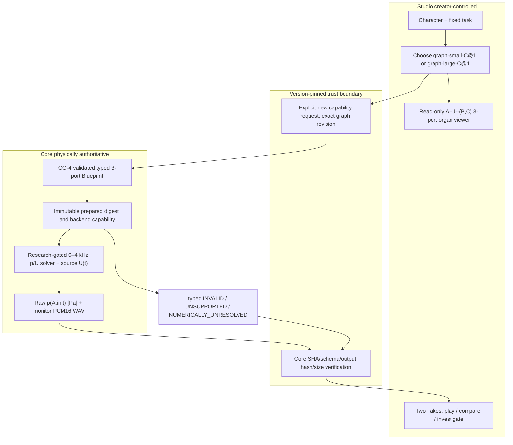
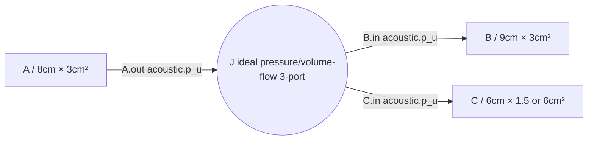

# OG-AUD1 — Studio creator handoff / read-only organ-graph audition

> 2026-10-20. **DESIGN CANDIDATE / no UI code, no new audio provider, no Studio contract changes.** [Core #130](https://github.com/ryonakayama234/morphoacoustics/issues/130) · [Studio #20](https://github.com/ryonakayama234/morphoacoustics-studio/issues/20) · [Core SYSTEM](https://github.com/ryonakayama234/morphoacoustics/blob/research/og-aud1-gatea-20261020/docs/research/og-aud1/SYSTEM.md) · [Core DATA](https://github.com/ryonakayama234/morphoacoustics/blob/research/og-aud1-gatea-20261020/docs/research/og-aud1/DATA.md) · [Core EXPERIMENT](https://github.com/ryonakayama234/morphoacoustics/blob/research/og-aud1-gatea-20261020/docs/research/og-aud1/EXPERIMENT.md).

## First creator outcome (future, bounded)

Existing adopted CC-A2 [PR #19](https://github.com/ryonakayama234/morphoacoustics-studio/pull/19) proves a creator can select validated 16.0/17.6cm serial bodies and save new physical audio Takes. OG-AUD1 must **reuse** its authoring/Takes model but introduce a **new separate, version-pinned capability**, not silently claim CC-A2 already synthesizes branching graphs.

1. Open Character in Studio. Same identity and fixed source task for both auditions.
2. Display two strictly validated branch-body options. Label the only physical difference: `C.area = 0.00015 m²` or `0.0006 m²`; visually highlight organ C and compare exact resolved graph digests.
3. Show three organ nodes (A,B,C) with their typed `acoustic.p_u` ports, connected by **one true 3-way ideal junction J**, not ordinary unconstrained lines.
4. Request fresh Core computation for each choice **after Core has independently validated a 0–4 kHz candidate**. Obtain physically computed source-port pressure p(A.in,t) [Pa], source volume flow U(t) [m³/s], inspectable full-port diagnostics and separate normalized monitor WAV. Do not use a canned fixture as actual output.
5. A/B listen one-shot and inspect two immutable Takes. Save/reload and optionally compare again after restart. Creator hearing a difference is a subjective observation **not a test of exterior sound or phonetic correctness**.

### Studio ↔ Core system graph



### Fixed organ diagram (viewer, not editor)



In diagram labels, `0.0003 m² = 3 cm²`, `0.00015 m² = 1.5 cm²`, `0.0006 m² = 6 cm²`. The short labels describe tube *areas*, not diameters. User-facing physical dimensions should display units and parameter identity, with full detail panel for immutable revisions. Rendered lines represent a validated Core Junction with pressure continuity and signed **volume**-flow conservation, not an arbitrary editor connection.

## Proposed data record / ownership (not a published schema)

```text
Character + Script/Direction                       [Studio, creative]
  └─ exact verified graph preset/version            [Studio chooser → Core lookup]
       └─ Core GraphBlueprint A,B,C,J + typed ports [Core semantics]
           └─ PreparedBranch3 digest/backend        [Core physical binding]
               └─ trusted volume-flow input U(t)    [Core input in m³/s]
                   └─ computed p(A.in,t)             [Core RAW physics in Pa]
                       ├─ full-port p/U/power       [Core diagnostics]
                       └─ labeled 48k PCM WAV       [separate playback derivative]
                           └─ validated immutable Take [Studio]
```

**Per Take verification fields:** source and request digest + physical body preset exact id/revision; original Blueprint/preparation hash and checked Core source revision; source-array / raw-Pa SHA-256, unit/endian/length/sample rate, monitor plane ID; spectral band/padding/FFT policy, solver and condition diagnostics; playback gain transformation and PCM digest; content-addressed immutable refs, validation status and archived timestamp. Studio must not rederive a false "Core-canonical" SHA via naive `JSON.stringify`.

**Allowed audition label:** `物理音圧モニター（音源Port・非放射音）` / `MONITOR_PRESSURE_NON_RADIATED`. **Do not call it:** actual mouth voice, calibrated SPL, human-like nasal resonance, or spatial/ear-received radiation. No waveform creation when physics refuses input.

## User-action and failure checklist

| Action | Expected future behavior |
|---|---|
| Select two frozen prepared graphs | Exact physical configuration comparison; same fixed task/source input |
| View node/edge structure | Explicit A-J-(B,C) with named ports and junction law; not editable topology |
| Perform once | One *fresh* Core calculation, fully validated receipt before saving playable Take |
| Play A/B | True distinct raw pressure if physical Gate B establishes difference; separately normalized audible monitor |
| Inspect explanation | Show changed C area, graph digest, fixed source identity, relevant p/U/pressure differences; no unsupported "phoneme" inference |
| Reload/restart | Original Take and graph version remain immutable, playable/inspectable |
| Unknown preset/changed SHA/illegal graph/out-of-band source | Clear INVALID/UNSUPPORTED/FAILED; **no playable Take and no fallback** |
| Core numeric instability/corrupt artifact | NUMERICALLY_UNRESOLVED or FAILED, no accepted audio |

## E2E acceptance gates / status ledger

- **A — System/Data/Experiment**: Core's three-part design and this Studio handoff reviewed, hypotheses and tolerances preregistered. Status now: **DOC CANDIDATE, NOT FROZEN**.
- **B — Core physical evidence**: Independently verified broadband response and waveform, source sample identity, conservation tests, hash repeatability, negative controls. Status: **NOT STARTED/NOT VERIFIED**.
- **C — Studio code**: UI/adapter exact-pinned to a verified Core capability; browser perform/compare/reload/restart; no fake or incompatible Take. Status: **NOT IMPLEMENTED**.
- **D — Adoption**: Independent numerical, contract/security, creator audio pilot (N=1 separately identified), explicit limited permission. Status: **NOT ADOPTED**.

Do not merge this planning PR as though B–D passed. An expert implementer may select the internal adapter details after physical and security review; user does not need to manage Git. Keep system graph, data map and experiment/audition ledger synchronized in **each subsequent implementing PR**.

## Gate A physical-audition UX amendment (2026-10-20, candidate)

Cross-repo evidence: [Core Gate A focused review](https://github.com/ryonakayama234/morphoacoustics/blob/research/og-aud1-gatea-20261020/docs/research/og-aud1/GATE_A_REVIEW.md). Under the **specific ideal, lossless, both-terminations-matched** OG-AUD1 fixture, changing distal B/C *tube length* alone cannot affect `p(A.in)`. Show **C cross-section** as the only selected physical intervention, rather than implying every organ dimension is audible. This is a restricted proof-of-concept, not a fully editable Character Creator.

Avoid a per-Take automatic peak normalization that destroys the physics-derived pressure-amplitude ratio. **Proposed A/B implementation gate:** use a documented common gain for the two clips, archive both raw Pa arrays and the pair gain/PCM receipts, and compare the two physical Takes only after both pass all Core and Studio trust checks. This is a candidate requiring a Core-backed finite source, gain/FFT preregistration and integration review; the current CC-A2 Stage A flow is not changed. The monitor is still labeled **物理音圧モニター（音源Port・非放射音）**, not a radiated creature voice.

### Artist-visible minimal result (future, not claimed implemented)

```text
same Character / same prescribed source U(t)
                 |
           frozen J topology
                 |
     +-----------+-----------+
     |                       |
C area = 1.5 cm²          C area = 6.0 cm²
     |                       |
Core raw p(A.in,t)        Core raw p(A.in,t)
     |                       |
     +-- one shared playback scale --+
                 |
       inspectable immutable A/B Takes
```

No new UI code, runnable adapter, verified 48k WAV or audition trial is supplied by this documentation-only update.

### Executed Core physical preflight — not Studio audio integration

Core [Experiment 043](https://github.com/ryonakayama234/morphoacoustics/blob/research/og-aud1-gatea-20261020/experiments/043_og_aud1_preflight/RESULTS.md) now has a **Wolfram-executed exploratory 12-state port-law calculation**, including matched-length null and wrong particle-velocity junction law. It validates no new browser functionality and emits no 48k WAV. Preserve the creator acceptance dependency `Core frozen broadband Gate B → pinned adapter → paired immutable Take → human listening`; no Studio bridge should treat this preflight as production entitlement.

## Creator pilot checkpoint — Experiment 044 (2026-10-20)

**Research audio exists but Studio integration remains NOT IMPLEMENTED.** The stacked [Core Experiment 044 Draft PR #132](https://github.com/ryonakayama234/morphoacoustics/pull/132) includes [runnable code + experiment/data diagram](https://github.com/ryonakayama234/morphoacoustics/blob/research/og-aud1-exploratory-monitor-20261020/experiments/044_og_aud1_monitor/README.md), [physical results and hashes](https://github.com/ryonakayama234/morphoacoustics/blob/research/og-aud1-exploratory-monitor-20261020/experiments/044_og_aud1_monitor/RESULTS.md), and new 12-state off-anchor Wolfram controls. Two 48kHz 1s **bandlimited p(A.in) source-port monitor** WAVs were locally generated with the same volume-flow source and **shared A/B playback gain**, 5 unit tests passed and two output folders matched byte-for-byte. No Core OG-4 public API was extended.

Proposed pilot should ask the creator to **listen one-shot** to the two artifact WAVs (not an automatic looping player), report (1) A/B distinguishability, (2) perceived timbral or loudness difference, and (3) whether this would be a useful *physical-body editing affordance*; no preferred/favorite voice is required and **these are not human words/phonation**. This listening can be done on safe user-downloaded clips pending a trusted Studio bridge. A/B creator data is qualitative N=1 and does not retroactively validate physical law.

Stage C may not begin by treating that exploratory source as an adopted trusted backend. Require reviewed/frozen Gate A, confirmatory Gate B, exact-pinned Core source and approved versioned new capability, strict source/pressure/WAV/hash and failure semantics, immutable pair-safe Take storage and browser perform→listen→reload. If the creator reports useful distinguishability, that motivates Gate C; if not, preserve results and investigate audibility independently without adjusting model parameters to chase preference.

**Current status:** `CORE_EXPLORATORY_MONITOR_EXECUTED` / `STUDIO_HANDOFF_DOCS_ONLY` / `CREATOR_LISTEN_PENDING` / `GATE_A_UNRATIFIED`.
