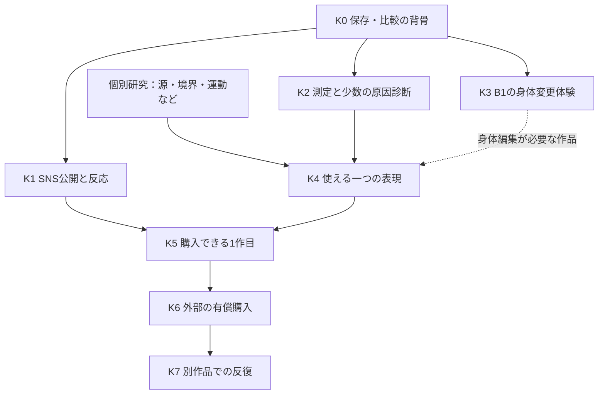

# R-20261115-05 — 身体から生まれる音を、公開・作品・最初の販売へ返す目標階層

**日付:** 2026-11-15 JST　**回答:** Research Lead（ChatGPT）　**審査:** Muse　**決定:** Owner  
**状態:** DESIGN_PROPOSAL / MUSE_REVIEW_PENDING / OWNER_ADOPTION_PENDING  
**本票:** [Q-20261115-05 / Studio Draft #67](https://github.com/ryonakayama234/morphoacoustics-studio/pull/67)（質問票 head `29dddfc05dbee7861c17a240177ab50d243d0c30`、[本文](https://github.com/ryonakayama234/morphoacoustics-studio/blob/29dddfc05dbee7861c17a240177ab50d243d0c30/docs/product/Q-20261115-05-roadmap-goals-subgoals.md)）、[追跡 Issue #66](https://github.com/ryonakayama234/morphoacoustics-studio/issues/66)。

本書1件だけを提出する。目標候補の登録、既存計画の変更、実装・実験・素材取得・制作・公開・販売・マージを実行または許可する文書ではない。以下の段数・分量・価格・予算・停止基準は、既存の凍結値を明記した箇所以外は採用候補である。売上の保証、自然音声の達成見込み、研究の残日数は提示しない。

## 0. 推奨と、今回確認した土台

**推奨は「作品先行、研究と作品は二つのトラック、合流は同じ身体・運動・観測の証拠で行う」である。** 最初の売り物は、身体から生まれた音を聴いて楽しむ小さな全年齢作品を第一候補とする。呼吸や近接が未成立なら、その約束を作品から外す。既存の短い固定演技を反復して長尺ASMRに見せることはしない。販売用に必要な表現が一つも成立しなければ、販売をHOLDしてSNSと原因を絞った研究へ戻る。

公開と販売の基準を分ける。**SNSには音質による公開可否判定を復活させない。** 売り物にする段で、既存の物理ゲートに加え、用途に合う音・創作者の受入・購入者に正直な説明・売り場の確認をそろえる。研究の全系統が完了するまで待つ必要はないが、欠けた物理を編集や商品名で補ってはならない。

### 0.1 情報源と事実の扱い

調査基準は **Studio main `47fa3f8571ffe2296c524e2111b2d32a4c06894e` / Core main `b2ec608fb19135ea2343c0416c790828e3820ba2`**。両treeは非省略で取得した。以下の文書本文と採用記録を参照した。古い文書の「提案中」ヘッダーより後続の決裁記録を優先する。コードの独立再監査・音声試聴・新たな費用計測は今回行っていない。

| 情報源 | 確認した限定事実／計画への制約 |
| --- | --- |
| 本票 §0–1、[SNS方針](https://github.com/ryonakayama234/morphoacoustics-studio/blob/47fa3f8571ffe2296c524e2111b2d32a4c06894e/docs/sns-policy.md) | SNS先行は決定済み。Shorts本命、TikTokは複製、Xは既存アカウント。既存の全年齢・20〜30分・880円・BOOTH先行は検討材料として扱う |
| [Studio凍結ADR](https://github.com/ryonakayama234/morphoacoustics-studio/blob/47fa3f8571ffe2296c524e2111b2d32a4c06894e/docs/product/STUDIO_WORKSPACE_V2_DECISION.md)、[品質RESET #32](https://github.com/ryonakayama234/morphoacoustics-studio/issues/32) | 閉じたスロットとSTOP-AND-PROPOSEを維持。数値合格と創作者の音質受入は別。却下された2 Takeの音源実物を今回同定していない |
| [BODYMAP回答](https://github.com/ryonakayama234/morphoacoustics-studio/blob/47fa3f8571ffe2296c524e2111b2d32a4c06894e/docs/product/body-module-map-response-20261111.md)、[G0採用記録E](https://github.com/ryonakayama234/morphoacoustics-studio/blob/47fa3f8571ffe2296c524e2111b2d32a4c06894e/docs/product/bodymap-g0-E-adoption-record-20261111.md)、[測定契約A](https://github.com/ryonakayama234/morphoacoustics-studio/blob/47fa3f8571ffe2296c524e2111b2d32a4c06894e/docs/product/bodymap-g0-A-measurement-contract-20261111.md) | S1–S7、C1/E1/E2を維持。測定契約v0は凍結済み、7 methodはDEFINED_NOT_VALIDATED。新しい「測定パックv0」を並立して作らない |
| [B1採用計画QP4](https://github.com/ryonakayama234/morphoacoustics-studio/blob/47fa3f8571ffe2296c524e2111b2d32a4c06894e/docs/product/body-b1-plan-response-20261110.md)、[正式ピン決定](https://github.com/ryonakayama234/morphoacoustics-studio/issues/54#issuecomment-6767339003) | P0/P1完了、正式B1ピンは`b5dc95ddbf00efe423635e8ff73f2b550239cd2b`。P2前のOwner-PCバックアップ再検査が必要。P2–P5の各判断をまとめて許可しない |
| [B2登録研究の結果と射程](https://github.com/ryonakayama234/morphoacoustics/blob/b2ec608fb19135ea2343c0416c790828e3820ba2/experiments/bodymap_b2_passive_loss/study-runs/BODYMAP-B2-20261113-01/README.md)、本票 §0 | G2完了、監督者裁定はIMPLEMENTATION_CONFORMANCE=PASS × EFFECT=EFFECT_DETECTED_IN_BAND。静止剛壁円管・100–800Hzの限定研究。全帯域音声・音質向上・Studio採用の証拠ではない |
| [逆路線回答](https://github.com/ryonakayama234/morphoacoustics-studio/blob/47fa3f8571ffe2296c524e2111b2d32a4c06894e/docs/product/reverse-route-response-20261114.md)、[段1登録](https://github.com/ryonakayama234/morphoacoustics-studio/blob/47fa3f8571ffe2296c524e2111b2d32a4c06894e/docs/product/reverse-stage1-preregistration-draft-20261114.md)、[凍結決定](https://github.com/ryonakayama234/morphoacoustics-studio/pull/65#issuecomment-6873567080) | REGISTERED_NOT_RUN。T-M採用、総render28/oracle84、wall2時間、保存2GiB。等価身体候補の有限識別で、実話者の解剖・好みの声の回収ではない |
| [Core VM0因果測定系](https://github.com/ryonakayama234/morphoacoustics/blob/b2ec608fb19135ea2343c0416c790828e3820ba2/docs/research/voice-metrology/SYSTEM.md)、[ASMR入口](https://github.com/ryonakayama234/morphoacoustics/blob/b2ec608fb19135ea2343c0416c790828e3820ba2/asmr/README.md) | prescribed source、口元観測、放射・受音の区別がある。ASMRパッケージはmetadata-only。実耳・近接・接触音生成を製品能力としない |

以下で **[F] は上記の事実、[H] は本回答の設計仮説、[U] は未確認**とする。BODYMAPのG番号、CoreのG1、逆路線の段番号は別系列。本書の製品マイルストーンは **K**、登録候補は **SG**、末尾のOwner判断は **M** と表記する。

## QB1 — 大目標：身体の創造性を、買われて繰り返せる作品へ

**推奨する大目標の1文 [H]:「自分で選び組み立てた身体とその運動が生む音を、来歴を保って作品に仕立て、聴き手に公開し、まず1作品が対価を払って買われ、その制作を別の1作品でも繰り返せる状態を作る。」**

達成物は、(a)聴ける公開サンプル、(b)買って再生できる作品と説明、(c)対応する身体・運動・観測条件・元Takeの参照、(d)支払い／配送成立の記録、(e)異なる2作目と制作費・時間の記録である。身体は人間でなくてもよい。最初は限定モデルの身体選択でよいが、将来の組み立て自由度へ進む方角を残す。「1秒の実験音が出る」「商品ページを作る」「売上だけ立つ」の単独では達成としない。

| 案 | 達成物と価値 | 利点 | trade-off・不足する前提 | 判断 |
| --- | --- | --- | --- | --- |
| A 作品先行 | 独自身体の短い音作品→購入→別作品。聴き手は研究を理解しなくても楽しめる | 既存Take/exportを生かし、全アプリのサポートを背負わず価値と支払意思を確かめる | 音の用途適合・構成・告知が必要。技術に興味があることと音を買いたいことは別 | **推奨主幹**。まず全年齢、SNSの反応後に販売判断 |
| B 道具／素材先行 | 身体を保存して演じさせる限定創作道具、または再利用許諾つき音素材パック | 身体差という操作可能性を価値にできる。自然な台詞がなくても用途が見つかる可能性 | アプリは対応環境・再現性・保存互換・サポートが律速。素材は有用な独立音の種類、許諾、ループ境界等が別に必要 | 素材を**条件つき分岐**、道具は後段。売れない作品を名称だけ素材へ変えない |
| C 研究エンジン先行 | 検証済みの限定物理能力と再現可能なデモ／技術提供 | 因果と科学の規律を最も直接に示す | 研究採用は購入需要の証拠ではない。少数の専門顧客への説明・保守負担が大きい | 研究資産として並行維持。最初の収入の主経路には置かない |

最初の購入は**自分の決済テスト・自己購入・依頼した応援購入を除いた、外部の有償注文1件**を最小の観測とする。返金等を別記し、決済と配布が成立したかを確認する。これは小さな支払意思の観測であり、収入の安定・市場適合・再投資可能額の証明ではない。研究に対する支援的購入か、音を使う購入かも分かる範囲で分ける。2作品を作れても売れなければ、制作反復は達成、販売反復は未達と記録する。

## QB2 — 出口で分解したマイルストーン [H]

**研究の合否、創作者が使えること、聴き手の価値、購入は別々の観測である。** 下表は製品の階層であり、研究G0–G8の名前替えではない。

| ID／短いタイトル | 聴ける・見える達成物 | 認定・観測条件（提案） | 下位依存 | その時点の出口 |
| --- | --- | --- | --- | --- |
| K0 保存できる身体の背骨 | Character→固定演技→不変Take→A/B→export | CHR-1の既存限定導線。[F]機能はmainに存在。UNKNOWN・品質未採用は残す | 既存契約・ピン | 内部制作の基準。アプリ販売・自由発話ではない |
| **K1 公開された身体の音** | 所有・利用条件を確認した既存音の短いSNS投稿と反応台帳 | 1件公開で初回達成、継続目安は1サイクル4投稿。**音質の合否は条件にしない**。品質が低いことも感想として記録 | K0の利用可能な音。欠損時のみ別GOによる書き出し／再採取 | Shorts→同素材TikTok／X。実験途中であることを明記して聴き手へ返る |
| K2 同条件で原因を比べる音 | 元Takeと観測面が分かる少数のA/A・A/B、既存v0に沿うsidecarと診断票 | 必要な量だけmethodを検証し認定可能範囲を明示。新旧差はsource/task/load/observerをそろえる。品質票は測定と別 | K0＋測定契約G0。旧音欠損はUNKNOWN | 「何が悪い／良い」を研究1件に返す。K1公開を止めない |
| K3 手元で変えられる身体 | B1閉カタログを選択・保存→実演→過去Takeと比較する既存スロット内の体験 | 採用済みB1 P2/P3/P4/P5の受入、旧Take保持、source状態の正直な表示。**音質GOは別** | K0＋B1 P0/P1＋Owner-PC条件 | 身体変更のデモ／制作素材。汎用器官エディタは主張しない |
| K4 作品に使える一つの表現 | 身体差を生かした、短くても用途がある非反復の音シーン／素材候補 | 必要な物理能力が個別採用され、K2で原因と限界を説明し、§QB4の創作者受入を満たす | K2＋必要な能力だけ。OD-2編集が必要な企画はK3。全研究完了は不要 | 無料の作品断片。作品か素材かを用途から選ぶ。ASMRを名乗る場合は約束する呼吸／近接等の能力が必要 |
| K5 購入できる1作目 | 全年齢の完成音源、サンプル、説明・ジャケット・配布物・価格・売り場判断の一式 | 本編全体確認、制作方法・内容・分量の一致、権利／分類確認、Owner販売GO。その後に掲載・配布導線を確認 | K1で反応を観測＋K4＋梱包・売り場確認 | 販売可能な商品。掲載完了を「売れた」としない |
| **K6 最初の有償購入** | 外部注文、配布成立、手数料控除後の記録 | §QB1の1件。公開後の観測期間・閲覧分母・売上0も報告。利益・生活費確保とは別 | K5＋実際の聴き手への到達 | **最初の販売検証**。資源への還元は実受取額から判断 |
| K7 もう一度作れる作品線 | 同じ身体または新身体で、内容の異なる2作目。制作手順・時間・保存量・反応の比較 | 既存作の水増しではなく別作品を完走。販売反復は外部購入が両作であった場合だけ認定 | K6の振返り＋制作能力 | 継続する作品線。素材需要や操作需要が実在すれば限定道具の検討 |

K1は「出す」、K4は「使える」、K5は「売れる状態」、K6は「買われた」。互いを言い換えない。K3とK4は一律の直列ではなく、作品が必要とする能力で合流する。

図は依存関係の提案で、実装済み配線やGOではない。逆路線はRの一候補で、K1/K4の必須入口に置かない。

## QB3 — 主幹と分岐：研究を待つ作品ではなく、作品の不足へ戻る研究

二つのトラックを分け、**共通の能力台帳・身体revision・元Take参照**で結ぶ。研究は法則と適用域を認定し、作品はその採用範囲の音を使う。研究が失敗しても既存能力でSNSは続く。作品が不評でも物理合格を取り消さず、品質原因を次の研究に戻す。制作のために別の音源エンジンを無断で足したり、凍結Studioの隣に作品用パネル群を生やしたりはしない。

主幹の固定順は **利用可能な音→SNSで反応→用途を絞る→必要表現の成立→商品化→販売判断・掲載→購入観測**。SNSの継続は各段に並行する。研究の順番はこの不足に応じて選び、すべてを主幹の関門に積まない。

| 資産／論点 | 配置・主幹／分岐の判断 | Kへの寄与と合流条件／根拠 |
| --- | --- | --- |
| Core物理・OMA語彙/G0 | 全経路の土台、現行契約を維持 | 語彙の凍結は任意組み立て可能性ではない。K0/K2/K3の正本で、物理法則をStudioへ移さない |
| Core G1 E1対照 | **後段／必要時の研究分岐**、保留維持 | 身体介入の因果主張を増やす時の証拠。SNSの開始・逆路線の実装計画・旧Take試聴の前提にしない。OMA G1とBODYMAP内のG1を区別 |
| BODYMAP B1 | **並行**、P2再開のPC条件を明示 | K3の固定主幹P2→P3→P4→P5。PC不在中に実装GOを仮定しない。固定M0/M1公開や作品の価値仮説は先に検討できる |
| BODYMAP B2 | **完了資産として保持**、製品接続は後段 | 再実験をロードマップの仕事として作らない。100–800Hzの結果を全帯域WAVの改善へ直結させない。K2の対照知識、K4に使うなら別の適用域・採用が必要 |
| B3 源の身体化 | **用途で優先しうる研究分岐** | 呼吸・囁き・発話内の息に必要ならS1/S2を先に。単一気流源の振動／乱流配分と漏れ・圧変動として検討し、息トラックの加算で代用しない。K4へ限定能力として合流 |
| B3 側枝・多源・動的弁 | **後段**、固定受動枝の知見は保持 | 非人間の身体差は長期の差別化だが、音の原因が未診断のまま自由グラフを増やさない。source系列と分け、必要なtopologyだけ個別採用 |
| 逆路線 段1→製作素材化 | **上限つき並行研究** | 凍結T/T-Mを実装計画→個別GOで閉じる。回収不能／曖昧も完了。出力は研究候補集合で、Character発行・好きな出演者の身体・販売素材ではない。段2には観測整合／権利／未知条件予測／採用の別ゲート。K4の必須依存にしない |
| 声質改善 3層 | **K2を小さく作り、必要な層だけ主幹へ** | 第1層は既存G0の実装・method検証であり再凍結ではない。第2層の5要因source/tract/boundary/observer/motionは一度に全走査せず、失敗に近い一要因を選ぶ。第3層の実装は診断の後。登録前の観察・仮説整理と、認定実験を分ける |
| SMC 言語→運動 | **台詞を商品約束にする時の主幹、当面後段** | 言葉を理解できる長い発話に必要。最初を非言語作品に絞れば一般TTSを待たない。研究Draftの存在を任意台本が読める証拠にしない |
| ASMR／Embodied Listener | **Aを用途分岐、Bを遠景へ** | A=ユーザーが聴く。近接・囁きが商品の核ならsource/S7/E1/E2が必要になり主幹へ昇格。B=身体同士が聴き合い行動するループは最初の作品の必須条件でない。metadata-only `asmr/` を音源として売らない |
| Studio背骨・凍結契約 | **固定土台**、洗練は個別提案 | K0を再制作しない。Character/Motion/Sceneは既存canvasのモード置換、Inspectorは許可パラメータ、transportは不変Take、drawerは証拠。新backend・Scene操作・音源コントロールを本計画で有効にしない |
| SNS定期公開 | **最優先の作品主幹＋全段に並行** | K1。既存チャンネル、短い素材を同じ編集で展開。品質理由では止めず、実演か研究途中かと実装範囲を正直に示す。公開行為そのものは後続GO |
| 最初の販売・売り場・年齢 | **K5/K6の主幹** | BOOTH先行案、DLsiteは方法全体を示して分類確認後。まず全年齢。価格と長さは下表の仮説から選ぶ。成人向けは別商品線・別素材・別掲載判断、最初の資金確保の前提にしない |

**捨てるもの [H]**は、身体因果を隠す音声加工、未実装器官の操作できるふり、資料の増加を進捗の代用品にする運用、既存音の反復で分量を稼ぐ商品案である。SMC・Listener・逆路線・非人間身体そのものは捨てず、用途で順番を変える。

### 最小の売り物をどう選ぶか

推奨商品の仮説は「同じ限定演技が異なる身体を通ることで生じる音の個性を、短い構成で楽しむ全年齢の音の小品」。これは**企画案で、現行M0/M1固定音が十分な素材を持つとの判定ではない**。単なる同じ短音の比較しか作れなければ無料サンプルに留める。台詞／呼吸／空間ASMRの能力を要しない形でも、聴く価値が成立するかを先に確かめる。

この小品は販売経路を小さく確かめる足場であり、**声・ASMRという最終到達像を達成したとの認定にはしない**。Ownerが「声／呼吸の作品以外には進めない」と選ぶ場合は、この商品仮説を棄却し、該当するsource・motion・scene能力が成立するまでK4/K5をHOLDする。信号音的であるという却下を「非人間だから」で回避せず、非人間の作品でもその用途の聴く価値を別に受け入れてもらう。

| 候補 | 分量／価格の仮説 | 使う条件 | BOOTH利用料控除後の1注文あたり概算 |
| --- | --- | --- | ---: |
| 小品（第一候補） | 5〜8分／330円 | 異なる展開のある短編。無意味な引延ばしなし | 266円 |
| 短編 | 10〜15分／550円 | 小品以上の表現の種類と構成を作れる場合 | 474円 |
| 既存案 | 20〜30分／880円 | 十分な音素材・演技が実在する場合に再検討 | 785円 |

価格は市場相場の推定ではなく、Ownerが比較する小規模検証案である。公式のDL商品利用料は **価格×5.6%＋45円、端数切上げ** [W1]。上表はその計算のみで、振込手数料・税・制作費・返金等を含まない。1件の小品販売でGPU購入等を賄えるとは扱わない。売上と実際に使える入金を分け、既存ストレージの確保を優先する案とする。

用途の問い合わせが「作品を聴く」より「自分のゲーム等でこの音を使う」に寄った場合は、独立音・使用条件・技術仕様をそろえる**素材パック**へ設計変更を提案する。操作したいという反応だけでアプリを有料化せず、保存・再起動・動作環境・サポート範囲・購入者が自力で目的を達成できることまで別に成立させる。

## QB4 — 目先の仕事と、あと何段か

### 4.1 いまの列を製品の地図へ戻す

| 目先の項目 | K上の場所 | 完了すると返るもの | それだけでは返らないもの／依存の扱い |
| --- | --- | --- | --- |
| B1 P2保留 | K3の橋の入口 | Core閉カタログrefとfaçade／pinの整合。受入前にPCバックアップ再検査 | 作品・自然音質・自由編集。続くP3/P4/P5を省略しない |
| 逆路線段1と実装計画 | K2/K4を支える並行研究 | 固定条件下で身体を区別できる／曖昧／回収不能という地図 | 実在音声からの身体素材、販売音源。K1/K5に直列接続しない |
| 声質改善3層未決定 | 主にK2→必要箇所だけK4 | 比較可能な観測→原因仮説→狭い改善候補 | 3層を一括採用した全音質保証。第1層の契約定義は既にG0で済んでいる |
| Core G1保留 | 身体介入の主張に必要なK2研究分岐 | E1対照の因果的証拠 | そのまま快い声、SNS反応、購入。既存Take公開の前置きにしない |

**段数は、既存の数えられる関門と、まだ未設計の能力を分けて表示する。**

| 到達点 | いまからの見通し | 不確実な箇所 |
| --- | --- | --- |
| **最初の聴ける公開 K1** | 利用可能な手元音があれば、対象・表示・公開範囲を決めOwner公開GO→投稿という**1回の公開判断**で届きうる。研究追加0段 | 現在の音声ファイルの利用可能性は未確認。欠損なら新しい採取／書き出しの個別GOが1工程以上必要。PC不在なら待つが研究全完了は待たない |
| B1の手元体験 K3 | 採用済み計画では**P2→P3→P4→P5の4段**。P2開始GOとバックアップ条件、P4前のUI提案・GOを含む | v1で橋渡し不能ならスキーマ判断が追加。4段は音質改善の残数ではない |
| 逆路線段1の研究結果 | これから**実装計画→実装GO→工学受入→実験GO→登録runと受入**。制作能力は別 | 登録内の結果は未観測。後段の実録音fitまでの残数は未定 |
| **最初の販売 K6** | K1から**K4の表現成立→K5の商品化・販売GO→K6の購入観測の3つの出口**。すでにK4が成立する場合のみ新たな物理研究0段で進めうる | K4に必要な表現は未確認。足りなければ原因に対応する個別研究が入る。研究の残数も購入までの日数も、現時点では数えられない |

「あとP2と逆路線を済ませれば売れる」とは言えない。一方で「すべての身体物理が完成するまで公開できない」も誤りである。カレンダーより、上表で今止まっている出口と、それを開ける証拠を毎回示す。

### 4.2 行き詰まりの診断 [H]

1. **完成の単位が研究の閉鎖に偏っている。** CHR-1やB2の成果はあるが、作品・購入者への価値という出口との接続が薄い。「何も返っていない」ではなく、機能・研究は返っているが、繰り返し聴きたいもの／買うものとして未成立と捉える。
2. **声道の改変で音源・放射・受音の不足まで解こうとしてしまう。** 現行のprescribed LF、限定運動、観測proxyの条件が固定なら、逆推定やS3細分化だけで呼吸・囁き・耳元の音は生まれない。どの箇所が耳障りさの原因かは未測定なので、sourceが悪いと断定せずK2で切り分ける。
3. **物差しは「無い」のではなく、定義と運用・資格の間が空いている。** G0凍結済みでもmethodはDEFINED_NOT_VALIDATED。測定パックをもう一つ設計するより、必要量の検証・観測と短い聴取票を接続する。
4. **安全に保存する手続きと、価値を生む仕事が直列化している。** 過去Take・ピン・入力契約を守る重さは必要だが、内部の仮説メモやSNSの質の採否に同じ登録機械を要求すると返却が止まる。
5. **Owner-PCと注意力が共有資源である。** 複数研究がそれぞれ「少量」の実機作業・大容量保存・試聴を求めると合計で破綻する。PC待ちの研究を全部同時に開始しない。

### 4.3 WG2を繰り返さない販売品質の関門 [H]

**SNS公開には適用しない。K4で用途を選び、K5で本編を確認する。** 単一の「自然さスコア」やG0数値だけで販売GOを出さない。研究比較と商品の聴感を分ける。

| 段 | 何を何で判定するか | 通過／失敗の扱い |
| --- | --- | --- |
| K2 原因診断 | 元音・body/source/task/load/observer/pinをそろえた短いA/A・A/B。測定は有効帯域・参照面つき。聴取は音量をそろえる必要がある場合も元データを保持し、同一の宣言済み再生尺度を用いる | モデルの不整合と、信号音的／耳障り／用途に合わないという聴感を別欄にする。比較不能なら品質改善の主張をせずUNKNOWN |
| K4 用途受入 | 20〜30秒程度の候補を最大4組、Ownerが短い2回の別機会に「この用途で最後まで聴けるか／変化に意味があるか／致命的な耳障りさがあるか」を記録。研究上の優劣のブラインド比較と、説明つき作品の価値判断を別にする | 1回10分程度を上限目安。Ownerが不採用なら用途を変えるか原因研究1件へ戻す。音の快さを数値PASSで押し切らない。本人の受入は一般聴取者への証明ではない |
| K1からの外部反応 | SNSで実際に聴いた人の感想を集める。「技術が面白い」と「もっと聴きたい／購入して使いたい」を分ける。販売前は可能なら外部2名以上の具体的な聴取反応を判断材料にする | 少人数の便宜的反応であり統計的認定にしない。無反応は露出不足・対象不一致の可能性がある。人数が集まらない時は不確実性を明記してOwnerが販売判断し、自動的なNOにもGOにもしない |
| K5 本編・配布確認 | 本編通し再生で欠損・過大なピーク・不自然な継ぎ目・説明にない反復、サンプルと本編の不一致を確認。対応再生環境と収録内容を明記 | 冒頭だけの良い断片で合格にしない。購入者が得るもの全体をOwnerが受け入れる。最初の小品は短くして確認可能な量に収める |

物理モデルの新旧比較で条件を変える必要があれば、変更点を明示して設計する。聴きやすくするための後付けEQ・リバーブ・息音加算・ニューラル美化で欠陥を隠さない。作品の区間選択・順序・無音・包装は行えても、元Takeと編集履歴を保持し、別々のTakeの配列を「連続して演技した身体」と説明しない。

## QB5 — Goals登録用のサブ目標候補（8件、すべて未登録）

各行はタイトル・現在地・2文の説明・完了の定義をそのまま登録文として使える形にした。**初めて「販売できる商品」に届くのはSG6、初めて「買われた」に届くのはSG7**。SG5は研究分岐で、SG6/SG7の必須依存ではない。

| ID／タイトル | 1行の現在地 | 説明（登録文） | 完了の定義（登録文） |
| --- | --- | --- | --- |
| **SG1 身体の音をSNSへ定期的に返す** | Character/Takeの背骨とSNS方針はあるが、本ラウンドでは手元音や公開実績を未確認。 | 既存の身体から出た短い音を、研究途中の状態も含めて聴き手へ返す。音質による公開ゲートを設けず、同じ素材を既定チャンネルへ展開して反応を残す。 | Owner公開GOの範囲でまず1件を公開し、1サイクル4投稿の公開物参照・元Take・表示・閲覧数と得られた感想を記録する。無反応も欠測として残し、継続か見せ方の変更を決める。（K1） |
| **SG2 声質のつまずきを同条件の音で説明する** | G0測定契約は凍結済み、7 methodの資格はDEFINED_NOT_VALIDATED。 | 元Takeと参照面が追える少数の音で、身体・源・境界・観測・運動のどこが問題かを絞る。測定資格の確認と短い聴取票を接続し、新しい改善実装を一つだけ選べる状態にする。 | 個別GO後、必要な測定量の適用域・検証状態、最大4組の比較、Ownerの用途判断、主要原因仮説1件と反証条件・次に要る能力を記録する。原因不明という結論も明記して閉じ、物理合格を音質合格へ読み替えない。（K2） |
| **SG3 限定身体を変えて保存・演技・比較できるようにする** | B1 P0/P1完了、正式Coreピンb5dc95d、P2はOwner-PC条件で保留。 | 採用済みB1 P2–P5を既存の個別判断のまま進め、閉カタログの身体差を創作者の手元に返す。旧Take、正本ref、sourceのUNKNOWN、凍結Studioの枠を維持する。 | バックアップ再検査を含むP2/P3/P4/P5が独立受入され、4非null revisionと2aliasの選択・保存・実演・A/B・export・再起動後読戻しが確認される。限定導線の完成と音質GOを別記する。（K3） |
| **SG4 一つの音表現を作品に使える形へ育てる** | 現行音の用途適合は未確認、呼吸・囁き・近接の製品能力は成立と扱えない。 | SNSの反応とSG2の診断から、最初の作品に要る表現を一つ選ぶ。既存能力で作れるならそれを使い、不足するなら対応する源・運動・境界等の限定研究だけを別GOで提案する。 | 用途と必要能力が明記され、使う能力が個別採用済みで、非反復の短い音シーンをOwnerがK4の基準で受け入れる。足りない場合は具体的不足とHOLDを記録し、成功扱いで閉じない。（K4） |
| **SG5 音から等価身体を選べる範囲を閉じる** | 逆路線段1はT＋T-Mを含み凍結済み、REGISTERED_NOT_RUN。 | 凍結登録を変えず、実装計画から個別GO・工学受入・実験へ進むかを判断する。実在話者の解剖や製品音源の取得とは区別し、有限カタログで分かることと分からないことを返す。 | 各独立GO後に登録全ケース・negative・hold-out・capの証拠がそろいMuseが受け入れる。唯一／曖昧／回収不能を分け、段2のGOや製品素材への昇格を自動発行しない。未完走はPARTIALで報告し完了認定しない。（K2/K4の並行研究） |
| **SG6 最初の全年齢作品を商品として成立させる** | 従来の20〜30分／880円案はあるが、使える表現・分量・売り場判断は未確定。 | SG1の反応を参照し、SG4の使える音から小さな完成作品を選ぶ。原則作品先行、5〜8分／330円を第一検討案として、サンプル・制作説明・配布物・分類・手取りをそろえる。 | 個別の制作GO後、本編全体のOwner受入、元Takeと編集履歴、商品説明／分量／価格／利用条件、売り場・年齢／制作分類の確認がそろう。販売GO後に購入可能な掲載・配布導線を確認する。**最初に販売可能な商品に届く目標で、売上達成ではない。**（K5） |
| **SG7 最初の有償購入を観測し次の判断へ返す** | 商品・外部購入の成立を本ラウンドでは確認していない。 | SG6の作品が対価を払って買われるかを、露出と費用を含めて観測する。売上0も記録し、音の用途・見せ方・売り場・価格のどこを変えるべきかを分ける。 | 自己購入等を除く外部有償注文1件以上と配布成立・返金等を記録し、売上と手数料控除後額を示す。採用した観測窓で0件なら販売達成は未達とし、露出不足／需要不成立／未解決を裁定して次の判断を残す。**「最初の販売」が現れる目標。**（K6） |
| **SG8 別の2作目で制作と販売の反復を確かめる** | 1作目の制作費・受取額・反応がまだない。 | 初作品の知見を使い、同じ身体または別身体で内容の異なる2作目を作る。制作手順と実機・手作業・試聴・保存の負担を測り、素材／道具の需要がある場合だけ次の分岐を提案する。 | 個別GO後に2作目の完成・配布と両作の費用・時間・反応・注文を比較できる。制作反復と外部購入の反復を別判定し、追加投資は実入金と必要額を確認して決める。（K7） |

推奨採択順はSG1/SG2を直近、SG3はPC条件成立後、SG4を用途確定後に具体化、SG6/SG7を販売の目標として明示登録、SG8を後続とする。SG5は既存の採用研究を可視化する並行目標であり、SG1より先に実行しなければならないという意味ではない。これらの採択も各作業のGOを兼ねない。

## QB6 — 今／次／その次／遠く

| 層 | 配置する目標 | 次へ進む出口条件 [H] | 止めて組み直す条件 [H] | 主な律速と小さな運用案 |
| --- | --- | --- | --- | --- |
| **今** | K0再利用、K1開始、K2の狭い診断。SG1/SG2、SG5実装計画の判断 | 既存音が公開され、反応と同条件比較から「誰が何を聴く作品か」「不足能力は何か」を1案ずつ示せる | 1サイクルで新しい音も診断結論も返らず文書だけ増える場合、次の登録票を止めて既存音の公開可能性と作業負荷へ戻る | PC不在・旧音の所在・Owner注意力。非実行の計画は1文書、試聴は1回10分程度、有料計算0円を既定提案 |
| **次** | K3はPC復帰後、K4は用途に必要な能力だけ。SNS並行 | 一つの音シーンが既存物理範囲と商品約束に一致し、Ownerが最後まで聴ける／使えると受け入れる | 原因1件に対する2回の限定改善ラウンドでも用途受入なしなら、同じ方向への微調整を止め、源／境界等の仮説または用途を再選択。回数は将来の採用候補 | 実装・独立検証・実機作業。進行中は重い研究1件＋作品側の短い返却1件を目安。B1と逆路線の正式runを実機に同時要求しない |
| **その次** | K5商品化→K6購入観測。SG6/SG7 | 内容・品質・表示・売り場がそろい販売GO。外部1件購入で最小販売検証、未購入なら露出等を分けて判断 | プラットフォーム分類未確認、許諾・由来が説明不能、商品とサンプルが不一致なら該当販売をHOLD。観測終了を成功にしない | 本編通し確認・梱包・告知・審査・手数料。価格を上げて固定手数料を薄めるためだけに長尺化しない。審査日数は未確認で予定を約束しない |
| **遠く** | K7、素材線／限定道具、SMCの台詞線、ASMRの物理受音、非人間モジュール、最後のニューラル、3企画の共有身体像 | 2作目が時間・保存予算内で完走し、用途が違う聴き手にも価値が観測される。購入反復が見えた分岐から拡張 | 作品より保守・問い合わせが重くなる、因果を捨てないと魅力が作れない、追加投資が実収入を継続超過する場合は範囲を縮める | 表現の種類、身体依存controller、外部利用者の環境、保守。GPU／課金は既存無料枠の存在を前提にせず、必要量と実資金を別判断 |

**全層の資源台帳 [H]:** CPU wall、Owner-PC占有、Owner手作業、試聴分数、原本／派生／作業中出力の保存量、現金支出を合算する。バイトが小さい既存短音と、長尺・stereoの制作物は別に見積もる。例として48kHz/24bit/stereoの8分PCM payloadは138,240,000 bytes（約132MiB）、30分では518,400,000 bytes（約494MiB）。WAVヘッダー・複製・作業traceは別であり、これは採用formatでもraw物理配列の費用見積りでもない。1系統だけを数えて空き容量を判断しない。

有効な研究登録capは本表で変更しない。特に逆路線段1の2時間／2GiB／render28・oracle84はそのまま。公開用圧縮ファイルや代表抜粋で日常運用の量を抑える案は取れるが、元Takeの保全・既存の研究証拠保存義務を勝手に削減しない。追加費用が必要になったら成果と不足額を提示して別判断とする。

## QB7 — 失敗・転換・手続きの重さ

### 7.1 何が起きたら大目標を縮めるか [H]

| 観測される失敗／サイン | 解釈と具体的な転換 | 維持するもの |
| --- | --- | --- |
| 源・声道・観測を絞った2回の限定ラウンドでも、Ownerが作品候補を使えない | 当該の「かわいい声／ASMR」到達を一度縮める。非言語の身体音に用途を変えるか、源・放射等の根本能力へ戻す。販売を急ぐための偽装加工はしない | 身体軸、過去証拠、SNSで途中経過を返す方針 |
| 4投稿×2サイクルで「もっと聴きたい／使いたい」が見えない | まず実際の露出と実聴コメントを確認。露出がほぼ0なら需要を棄却せず見せ方・対象を1点変更。複数の実聴者が用途に一貫して否定的なら作品仮説を変更 | 低露出と音の価値の不成立を区別 |
| 外部購入0 | 例えば販売後30日の窓で記録する案。商品ページ閲覧分母が不足なら未解決、十分届いても0なら価格／用途／説明の一つを変える再試行をOwnerへ提案。少数閲覧で「売れない」と断定しない | 注文0を未達として残す。観測期間は販売時に固定、延長は別判断 |
| 商品ページに来る人はいるが、声でなく素材利用を尋ねる | 素材パックへ分岐。使う場面・独立音の種類・許諾・形式を設計し直し、作品のファイルをそのまま再命名しない | 同一身体と元Takeの来歴 |
| 好評でも実機・手作業・保存がcapに入らない | 尺・身体数・出力形式を縮める、既存キャッシュ再利用を条件つき検討。法則の変更や証拠省略を「高速化」と呼ばない | 意味論と品質。新たな予算超過を隠さない |
| 身体因果を消すニューラル処理がなければ商品が成立しない | 現在の製品仮説をHOLD。残差／推定器の限定役割を別審査し、body/task介入・実行不能・neural OFFの監査を通せないなら採用しない | 物理の権威と本企画の差別化 |
| 想定より早く公開反応・品質が良い | 作品梱包・価格・売り場確認を前倒し。道具を求める人が実在するなら小さな操作観察の設計を前倒し | B1、Core G1、逆路線、UI、販売それぞれの個別GOを省略しない |

2回／4投稿／30日は本書の運用提案で、既存登録の停止値ではない。統計的な成功閾値として用いず、無期限に微調整を続けないための判断窓にする。売上が少額で継続収入にならなければ、「研究と小規模作品制作」へ範囲を縮めることも正当な結論である。

### 7.2 厳密さを集中する場所

| 段／行為 | 維持する規律 | 軽くする案・禁止する膨張 |
| --- | --- | --- |
| 目標案・企画・原因仮説メモ | 情報源、事実／仮説／未確認、Owner判断点 | 1文書／短い表で選択可能にする。検討案をすべて事前登録へ増殖させない |
| 未認定の探索・デモ案 | 元データ、条件、費用、探索である表示。実行が必要なら別GO | 科学的成功の閾値を置かず、後の認定データと区別する。探索を理由に凍結仕様を改変しない |
| 物理法則追加・method資格・因果的改善主張 | 事前登録、独立参照、単位／参照面、対照・負例、予算、exact pin、停止・UNKNOWN | 重さを維持。用途に必要な一能力へ範囲を絞り、物理基準を下げない |
| 凍結済み研究の実装・実施 | 凍結値、工学受入、実装GOと実験GOの分離、hold-out、全結果 | 逆路線を本書で再登録しない。B2完了も再実験しない |
| SNS公開 | 由来と制作方法、投稿先のルール、Ownerの公開範囲・GO | **音質による採否は置かない**。投稿ごとの巨大な物理監査やOwnerブラインド試聴を求めない。既存採用範囲の証拠を再利用 |
| 作品の構成・包装 | 元Take・編集履歴、内容一致、権利／販売分類、全体試聴 | 区間構成・ジャケット・説明の変更を科学実験として登録しない。物理にない表現を付け足さない |
| 製品採用・Studio変更・ピン移行・販売 | 個別Owner GO、独立受入、旧Takeと凍結スロット、公開可能な具体物の確認 | 関門は維持。研究PASSで品質や販売を自動承認しない |

### 7.3 販売と参照音声で止まる条件

以下は法律適合の認定ではなく、具体的な制作方法を説明して売り場と利用条件を確認する計画である。確認待ちは該当の販売／素材利用に限定し、無関係な既存自作音のSNS公開や文書検討まで止めない。

| 論点 | 提案する扱い | STOPの対象・解除に必要なもの |
| --- | --- | --- |
| **DLsiteのAI区分・運営確認** | 自作物理合成、ニューラル利用の有無・役割、台本、ジャケット等を分けて運営確認する。一般の「AI音声合成」説明から自作システムの扱いを推測しない | **DLsite掲載をHOLD**。今回サークル向けヘルプの現在本文・審査所要日数は直接検証できずU。公式2024年告知[W4]だけで現在の個別区分は決まらない。Ownerが問い合わせを承認した後、回答と適用条件を記録して再判断。問い合わせは本ラウンドでは送らない |
| **BOOTH先行と制作表示** | BOOTHも無条件に通るとはしない。公式は特定作者等への強い依拠や大量・連続出品への対応を示し[W2]、2026年11月12日改定では販売内容の不明瞭さも明確化している[W3]。何が届くか、物理合成の範囲、未対応の表現を簡潔に示す | 制作方法が説明不能、個別問い合わせが必要な未解決点、具体的な規約上の懸念・掲載拒否があれば該当商品HOLD。別名義や別サイトで同じ拒否を回避する計画にしない |
| **参照音声の解析と再配布** | RJ01745881 Track 3は未取得のまま。解析の許容範囲・入手経路・商品ライセンス等を利用前に確認し、不明なら許諾素材または自己収録・合成対照へ替える。購入できることを解析・模倣・商用利用の包括許可とみなさない | 許容範囲不明の参照を段2の制作に入れない。原本・切出し・復元可能なデータを公開repoや配布物へ入れない。「再配布しない」だけで全権利問題が解決したとは扱わない |
| **等価身体と声の同一性** | 有限モデルの候補集合を特定出演者本人の身体・本人認定の声として売らない。研究の観測一致と、実在者の声の商用模倣は別に扱う | 実在者への誤認や由来・許諾の未解決がある企画をHOLD。独立に設計した身体と、由来を説明できる音へ戻す |
| **全年齢／成人向け** | 最初は全年齢で声・身体音の価値を検証。成人向けは後の別作品・別説明・別公開素材・別年齢区分判断にし、既定SNSへ成人音源を自動複製しない | 年齢区分・表示・掲載先適合が不明な当該素材の公開／販売をHOLD。全年齢の別素材まで一括停止しない。成人向け表現がないと価値がないと観測されたら、Ownerが目標を改めて選ぶ |
| **SNS上の合成表示** | 自作物理合成と実収録を混同させず、AI使用の有無も制作工程どおりに記す。各投稿先の当時の開示項目・年齢条件を公開時に確認する | SNSに音質の関門を設ける話ではない。第三者素材や誤認表示等、当該投稿の具体的問題があればその投稿を止めて解く |

### 7.4 運用の一回分をどう返すか

Research Leadは毎回「現在止まるK／使える音の参照／不確実性1件／次に選ぶ行為／Owner時間と費用／必要な個別GO」を短く返す。Museは既存決裁・入力・数式・主張範囲を検証する。Ownerは聴く価値と採否を決める。能力を増やした時には、文書に加えて次の個別GOで返す聴ける物を指名する。**本書でその制作や公開を開始しない。**

## Owner判断点 M1〜M9（本ラウンドの採否用）

未回答は採用とみなさない。ここでYESになっても、対応する実装・実験・制作・公開・販売のGOは別である。

| 判断点 | 推奨採択案／選択肢 | 決めること・既存判断との対応 |
| --- | --- | --- |
| **M1 大目標と第一商品** | QB1案A、全年齢の作品先行。素材は用途反応があった時、アプリ販売は後段 | 身体軸を保った最初の商業到達点。自由な器官編集完成を初販売の必須条件にしない |
| **M2 二つのトラック** | 研究と作品を分け、能力台帳・身体・元Takeで合流 | 逆路線／Core G1／全BODYMAP完了をSNS・販売の一律前提にしない。既存個別GOの緩和ではない |
| **M3 登録候補の採択** | SG1〜SG8から選ぶ。SG6=商品化、SG7=初販売を明示的に残す | Goals登録する項目・順序。SG5は独立研究、SG3はPC条件のある既存計画を可視化 |
| **M4 直近に返す物** | まず既存手元音の公開候補とK2の狭い比較案 | 本判断は候補選定の方針まで。公開範囲・実行・公開GOは後続。PC不在／音欠損時は所在と不足を先に返す |
| **M5 最初の分量・価格仮説** | 5〜8分／330円を第一検討、10〜15分／550円、従来20〜30分／880円と比較 | 収録可能な表現から選び、分量を守るために水増ししない。BOOTH先行・DLsite確認後の枠は維持 |
| **M6 品質と公開の線引き** | SNSには品質採否なし、K4で用途受入、K5で本編確認 | WG2却下を維持。音質の判定と物理認定、少人数の感想と一般市場の証明を分ける |
| **M7 小さな作業枠** | 重い研究1件＋短い作品返却1件、Owner試聴1回10分目安、有料計算0円を既定提案 | 全企画と共有するPC／注意力予算として調整。既存登録capを変更しない |
| **M8 振返り窓と転換** | SNS4投稿×2サイクル、限定改善2回、販売観測30日の提案を採否 | 無反応・低露出・不評・未購入を分け、成功を後付けしない。日付保証や自動実行の設定ではない |
| **M9 後段の優先分岐** | 呼吸・囁きが商品核ならsource＋放射／受音、台詞核ならSMC、素材需要なら素材線 | BODYMAP B3 source/branchを分離。B1 P2、逆路線段1、Core G1の個別判断点と対応づけるが代行しない。三企画統合とListener相互ループは遠景 |

## 外部確認資料（2026-11-15参照）

プラットフォームの現行説明に基づく限定的な計画材料。公開・販売を実行する時点で再確認する。法的適合性・審査通過を認定した資料ではない。

- **[W1]** [BOOTH公式ヘルプ：売上にかかるサービス利用料](https://booth.pixiv.help/hc/ja/articles/115004576874)。DL商品の5.6%＋45円・端数切上げ。QB3の手取り算術の根拠。
- **[W2]** [BOOTH公式：AI生成作品への対応強化（2025-07-18）](https://booth.pm/announcements/828)。依拠性の高い商品・大量連続出品等への対応。Morphoの個別許可の証拠ではない。
- **[W3]** [BOOTH公式：個別規約改定（2026-11-12施行）](https://booth.pm/announcements/1003)。具体的販売内容が不明瞭な出品等についての説明。現在の個別商品適合は販売時判断。
- **[W4]** [DLsite公式：AI生成フロアの告知（2024-02-15）](https://info.eisys.co.jp/dlsite/4628201220b668fe?locale=en_US)。区分があることの歴史的確認に限定。現在の自作物理合成音声・台本・ジャケットを含む区分は未確認で、運営確認を省略しない。

**提出の効力:** 本書は目標階層と判断候補を示す設計回答1件である。既存の採用・凍結状態、品質HOLD、研究登録、Studio契約、個別GOを変更しない。実装・実験・制作・公開・販売・マージは未実施。
