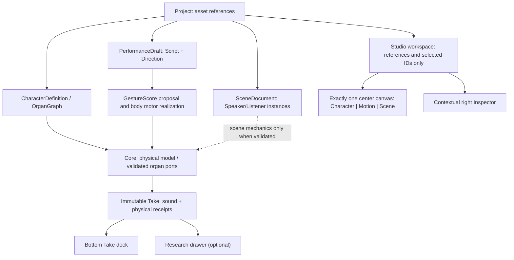

# ADR — MORPHO Studio Workspace V2: approved product layout

**Decision:** ACCEPTED / FROZEN (creator, 2026-10-26 JST)  
**Scope:** visual composition, feature placement, and data ownership, **not** current rendering capability, sound quality, or permission to edit UI today.  
**Reference implementation:** [Draft #33](https://github.com/ryonakayama234/morphoacoustics-studio/pull/33), frozen design branch `design/workspace-v2-shell-20261025`, baseline `d62f88808cf02db5d193fe68ba15efef6a02194c`.  
**Product issue:** [#32](https://github.com/ryonakayama234/morphoacoustics-studio/issues/32); creator future-UI gate is recorded [on Draft #33](https://github.com/ryonakayama234/morphoacoustics-studio/pull/33).

## Decided: one creation workspace, not vertically stacked experiments

The creator explicitly accepts this **composition** as the baseline. Keep the central canvas visually dominant and spatial/depth-bearing. Use neutral grayscale, controlled light and shadow, concise labels, clear selection/focus, and almost no explanatory prose in primary workflow. The application is a character-and-performance creation studio, not a diagnostic dashboard.

Exactly three mutually exclusive **modes**, not separately appended panels:

1. **Character** — character creation, physical organ modules as nodes and typed physical/functional connections as edges, anatomy, materials and bodily identity. Existing 1D acoustic tract models are not a generalized editable organ graph.
2. **Motion** — script, directions, gesture planning, perform and eventual 2D/3D bodily articulation. Reuse compatible, scientifically gated `packages/speech-motor-compiler/` logic rather than introduce a fourth mode.
3. **Scene** — Speaker / Listener staging, space, future 2D/3D movement, collision and contact, physical sound reception and optional ASMR modules as gated scene behavior. Scaffold until validated.

Switching modes **replaces** the central editor and associated contextual Inspector. It never appends a new experiment/card farther down the page.

## Fixed panel responsibilities (normative)

| Slot | Position | Owns / displays | Must not own |
| --- | --- | --- | --- |
| `global.header` | top | project identity, mode navigation, status | research backend controls |
| `project.library` | left | navigation to Character, Body, Script, Scene, Take **references** | copies of physical model data |
| `character.canvas` | shared center when Character | organ module graph selection and eventually validated editing | generated waveform or solver truth |
| `motion.canvas` | shared center when Motion | Script / Direction / MotionScore timeline | physical topology or scene contacts |
| `scene.canvas` | shared center when Scene | Speaker / Listener instances and eventual stage manipulation | editing the shared Character anatomy by copying it |
| `selection.inspector` | right, contextual | selected entity's allowed parameters and status | separate duplicated entity state |
| `take.transport` | bottom, permanent | playback, timeline, A/B, export for immutable Take references | solver configuration or scientific log walls |
| `research.drawer` | hidden by default | receipts, physical trace, diagnostics, provenance and hashes | creator-facing default vertical panels |

This set is **closed**. New functionality must fit into one existing slot. A proposal to revise the slots, add a mode, or place a new panel requires explicit creator approval *before any UI code or panel registry modification*.

## Data-flow and source-of-truth boundaries

- **Character/OrganGraph** owns its graph's versioned organs, typed ports/edges, material distribution, and capability metadata. Core remains the authority on *physical legality and solver execution*. The proposed `OrganGraph` is **not** claimed to be an existing general Core API.
- **Performance** owns script, directions, optional task-level coordination/gesture score and motor realization request references. Gestures must pass through body-dependent physical feasibility, not audio splice/crossfade.
- **Scene** owns instances/roles/transforms/environment/contact requests, referencing immutable Character revisions. It does not duplicate anatomy or claim 3D/FSI/contact acoustics before implementations exist.
- **Take** owns an immutable acoustic observation and exact source, body, motor, scene, solver revision/provenance references. Waveforms are observations, **not** the canonical voice/character model.
- **UI state** owns only mode, selection IDs, viewport and playback position. Editor components may change owned entities through validated domain APIs; they must not independently become authoritative physics stores.
- **Neural** components may assist proposals, inference and physically constrained closure when separately validated; never fabricate physical cause or covertly reconstruct a physically impossible voice.

## UI freeze / strict future change gate

**The visual layout and placement are accepted. The creator explicitly placed a STOP-AND-PROPOSE gate on further Studio UI changes.** Do not edit panels, styles, mode routing, interactions, `src/App.tsx`, `src/workspace/*`, preview, or the panel registry just because a new Core capability is available.

When an actual new physical/Character-Creator capability calls for interface work:
1. **Stop and propose**, before any Studio UI edit: creator action/task; owning domain and canonical data/schema; existing slot (central tab + Inspector); validated backend capability/receipts; interface/contract change; old-Take preservation; compact interaction sketch; risks.
2. Obtain explicit creator authorization for that particular UI change, then implement narrowly in its fixed slot.
3. Update this document and the system/data diagrams only if a domain contract **actually changes**; do not treat design documents as permission to implement speculative features.
4. Use CI plus `@codex review` when available. Physically causal correctness and actual human-perceived sound quality are separate release gates.

## Adoption boundary (important)

- `main` application remains the previous entrypoint. **This decision does NOT merge Draft #33**, switch the default UI, or accept WG2/any sound renderer.
- Draft #33 is a **visual reference and isolated preview** only; its current HEAD passed CI but Codex reported **three unresolved P2 findings** (tablet horizontal overflow, a seemingly functional but inert body selector, and invalid keyboard semantics for ARIA tabs). Fixes to that preview are subject to the above STOP-AND-PROPOSE rule; **no unreviewed Draft merge**.
- Preserve existing Takes, pinned contract, X2a/CC-A2/B1 and the audio quality HOLD on Studio #31 / Core #193. Motion/Scene physics and general graph execution are explicitly future capability.
- The creator's approval means **the design concept is final**, not that these capabilities are built. Future product expansion can occur within this fixed design after the explicit change gate.

## Historical architecture reference (not presently merged)

The initial (not authoritative until individually adopted) domain model/slot proposals are recorded in Draft #33:
- [PANEL_REGISTRY.json](https://github.com/ryonakayama234/morphoacoustics-studio/blob/d62f88808cf02db5d193fe68ba15efef6a02194c/docs/product/workspace-v2/PANEL_REGISTRY.json)
- [DATA_MODEL.md](https://github.com/ryonakayama234/morphoacoustics-studio/blob/d62f88808cf02db5d193fe68ba15efef6a02194c/docs/product/workspace-v2/DATA_MODEL.md)
- [SYSTEM.md](https://github.com/ryonakayama234/morphoacoustics-studio/blob/d62f88808cf02db5d193fe68ba15efef6a02194c/docs/product/workspace-v2/SYSTEM.md)

**Future working rule:** first identify the *owner and fixed slot*, then the physical capability and versioned contract; don't grow the screen vertically to accommodate each new experiment.
