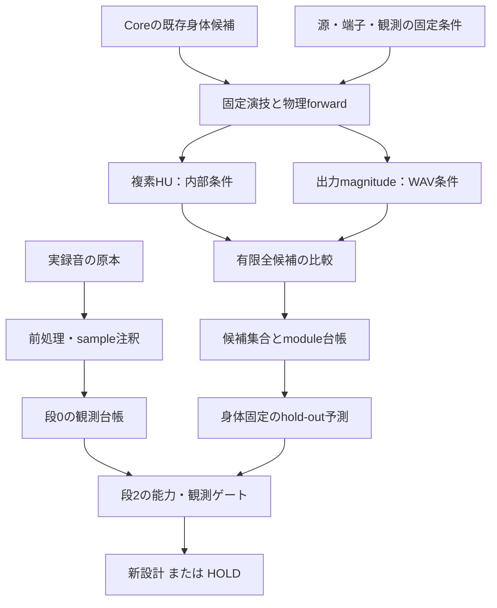

# REVERSE-R-20261114-01 — 音→身体：段0・段1の設計回答

**日付:** 2026-11-14 JST ／ **回答:** Research Lead（ChatGPT）／ **審査:** Muse ／ **決定:** Owner  
**質問票:** [REVERSE-20261114-01](reverse-route-questions-20261114.md)、[Draft PR #64](https://github.com/ryonakayama234/morphoacoustics-studio/pull/64)、[Issue #63](https://github.com/ryonakayama234/morphoacoustics-studio/issues/63)。  
**状態:** DESIGN_PROPOSAL / MUSE_REVIEW_PENDING / OWNER_ADOPTION_PENDING。本書1件のみの追加。設計処方であり、事前登録の発効、実装、実験、ツール製作、素材ダウンロード、製品ピン変更、マージの GO ではない。

## 0. 質問票への回答の要約

**推奨は、段0を「録音された観測の台帳」、段1を「既存の身体候補を音から区別できるかの有限逆問題」として進めること。実在の声全体から編集可能な等価身体を得る段2は、現状では HOLD。** 段0・段1の完了を段2の自動 GO にしない。研究として完了できることと、製作素材として使えることを別に判定する。

| 問い | 回答・第一選択 | 完了時にも残る制限 |
| --- | --- | --- |
| QR1 成果物 | 研究用の身体候補集合＋モジュール別同定可能性台帳。既存 Core receipt を参照し、運動・源・観測を分離 | Character や新しい BodyRevision を研究側で発行しない |
| QR2 合成逆問題 | OD-2 の **5つの異なる身体**を全候補評価。内部の複素応答と、出力スペクトルだけの推定を別条件にする | 有限集合内の回収であり、連続形状・解剖・未知話者の同定ではない |
| QR3 実在音声 | 全体のデジタル信号統計＋上限を決めた区間測定。4層アノテーション。素材未取得のまま手順を設計 | Pa、声帯波形、声道伝達、器官状態を録音から直接観測したことにしない |
| QR4 前処理 | 原本・sample対応・加工履歴・注釈・測定参照を持つローカル入力パッケージを先に紙で固定 | QT下書き原文は未取得。質問票が列挙する6論点への処方であり、原文照合は MQ1 |
| QR5 次段 | 波形だけでの候補再現、未知条件での予測、body/motion分離、実録音との観測整合が必要 | LF100固定・固定演技・録音経路不明という現行制限では「好きな声の核を再現した身体」を認定できない |
| MQ | 4点を裁定依頼：背景資料、初回の有限集合、録音sidecarの互換表現、段2の最小主張 | 未回答を AGREE としない |

**証拠の区別:** 以下の **[F]** は確認した限定事実、**[H]** は本書の設計仮説・採用候補、**[U]** は未確認。本書の数値・状態名・ファイル項目の提案を、既存APIや実験結果と読まないこと。

## 1. 確認した正本と、設計を変える事実

調査時の Studio main は `a3456293670421a384458394d6841ca6ebcc0b3d`、質問票 head は `f35e9f9e4cc307577936645da89011de31d9f931`、Core main は `b2ec608fb19135ea2343c0416c790828e3820ba2`。両 repo の README、以下の文書・実コード・Issue/PR記録を確認した。READMEの初期説明より、個別能力の採用記録とピンを優先した。

| 正本・確認対象 | 今回の判断への帰結 |
| --- | --- |
| [BODYMAP回答](body-module-map-response-20261111.md)、[Character回答](character-v0-response-20261106.md) | S1〜S7 と C1/E1/E2 の責務を維持。16区間は S3 の数値表現であり16器官ではない |
| [G0 A](bodymap-g0-A-measurement-contract-20261111.md)、[B](bodymap-g0-B-pack-schema-proposal-20261111.md)、[method manifest](bodymap-g0-B-feature-method-manifest-proposal-20261111.json)、[C](bodymap-g0-C-retrospective-unknown-ledger-20261111.md)、[D](bodymap-g0-D-five-factor-preregistration-20261111.md)、[E](bodymap-g0-E-adoption-record-20261111.md) | Eにより契約定義は凍結済み。7 method は全て DEFINED_NOT_VALIDATED。古いヘッダーのPROPOSAL表記から未凍結と誤読しない。過去UNKNOWNを修復しない |
| [CC-A2 Studio記録](../cc-a2-two-body-studio.md)、[Core cc_a2_live.py](https://github.com/ryonakayama234/morphoacoustics/blob/b2ec608fb19135ea2343c0416c790828e3820ba2/tools/cc_a2_live.py)、[Fidelity 0](https://github.com/ryonakayama234/morphoacoustics/blob/b2ec608fb19135ea2343c0416c790828e3820ba2/docs/fidelity-0.md) | 本体の無損失・source-free入力インピーダンスと、研究レンダラーのloaded transfer/WAVを混同しない |
| [OD-2 SYSTEM](https://github.com/ryonakayama234/morphoacoustics/blob/b2ec608fb19135ea2343c0416c790828e3820ba2/docs/research/od2-reusable-physical-body-20261102/SYSTEM.md)、[RESULTS/R1/R2](https://github.com/ryonakayama234/morphoacoustics/blob/b2ec608fb19135ea2343c0416c790828e3820ba2/docs/research/od2-reusable-physical-body-20261102/RESULTS.md)、[CLI](https://github.com/ryonakayama234/morphoacoustics/blob/b2ec608fb19135ea2343c0416c790828e3820ba2/tools/od2_body_cli.py)、[catalog](https://github.com/ryonakayama234/morphoacoustics/blob/b2ec608fb19135ea2343c0416c790828e3820ba2/contracts/body/od2-b1/catalog-v1.json)、[Studio #54決定](https://github.com/ryonakayama234/morphoacoustics-studio/issues/54#issuecomment-6767339003) | c={4,8}, r={0.90,1.00,1.10}のみ。6要求は4改変＋同じM0への2 alias。B1正式ピン b5dc95d、P2は別判断。最新mainを製品ピンにしない |
| [OD-1 run](https://github.com/ryonakayama234/morphoacoustics/blob/b2ec608fb19135ea2343c0416c790828e3820ba2/experiments/od1_local_shape/run.py)、[oracle](https://github.com/ryonakayama234/morphoacoustics/blob/b2ec608fb19135ea2343c0416c790828e3820ba2/experiments/od1_local_shape/oracle.py)、[Exp009](https://github.com/ryonakayama234/morphoacoustics/blob/b2ec608fb19135ea2343c0416c790828e3820ba2/experiments/009_fixed_tract_waveform/run.py) | 実際の旧WAV経路は一様減衰 **0.4 Np/m**、抵抗端子 `0.05ρc/Aout`、0.20m monopole proxy。これはLRFでもFidelity0本体の損失でもない |
| [Exp027](https://github.com/ryonakayama234/morphoacoustics/blob/b2ec608fb19135ea2343c0416c790828e3820ba2/experiments/027_task_field_vowel_transition/run.py)、[OD-3 RESULTS](https://github.com/ryonakayama234/morphoacoustics/blob/b2ec608fb19135ea2343c0416c790828e3820ba2/docs/research/od3-reusable-body-performance-20261102/RESULTS.md)、[実コード](https://github.com/ryonakayama234/morphoacoustics/blob/b2ec608fb19135ea2343c0416c790828e3820ba2/experiments/od3_body_performance/run.py) | 既存の研究用G1はT1の20ms遅延だけ。対象身体もM0/c4-r1.10/c8-r0.90の3つだけ。未知発話と呼べないが、運動条件hold-outの限定候補にはなる |
| [B2回答](body-map-g2-response-20261112.md)、[Muse審査](https://github.com/ryonakayama234/morphoacoustics-studio/pull/62#issuecomment-6822104853)、[Core #298限定採用](https://github.com/ryonakayama234/morphoacoustics/pull/298#issuecomment-6870957384)、[study README](https://github.com/ryonakayama234/morphoacoustics/blob/b2ec608fb19135ea2343c0416c790828e3820ba2/experiments/bodymap_b2_passive_loss/study-runs/BODYMAP-B2-20261113-01/README.md) | 100–800Hz、静止剛壁円管のLRF適合・効果検出まで。raw runnerのFAIL表示は一様管反転という空虚なmutationに対する監督者裁定が正本。逆同定・Studio統合・全帯域採用の証拠ではない |

**[U] 未取得:** 背景メモとQT下書きは取得したGitHub treeに存在せず、[監督者へ参照を照会済み](https://github.com/ryonakayama234/morphoacoustics-studio/pull/64#issuecomment-6871145478)。Track 3の実ファイル、長さ、チャンネル数、無音・囁き・接触音の有無は未確認。「SEなし48kHz/24bit」は質問票の予定条件であり、ファイル検査済みの事実ではない。

## QR1 — 凍結する成果物と等価身体の表現

### 2.1 出力は、代表候補1つと説明可能な候補集合

**[H] 研究記録 `reverse-body-candidate/0-proposal` をBody Assemblyへの注釈付き参照として設計する。実行スキーマは本書では発行しない。**

| 項目群 | 凍結候補の内容 |
| --- | --- |
| identity/provenance | record ID、content SHA、親記録、issuer、日時、研究/登録ID、Core/solver/adapterのexact SHA、依存lock、推定手法/設定SHA、入力原本/抜粋/観測配列SHAと範囲 |
| claim | `INFERRED`、`IN_MODEL_SYNTHETIC`または将来の`REAL_RECORDING_CONDITIONAL`、対象module、観測条件、主張の上限、未モデル要因、UNKNOWN理由。合成正解は評価専用 `SYNTHETIC_TRUTH` 別票で保持 |
| body | S3=`organ.tract.serial1d`への既存Core revision/parent/preparation_digest参照。family/c/r、16断面と長さは監査用readback、Body発行の第二正本にはしない |
| other modules | S1/S2/S4/S5/S6/S7の固定・未モデル・未同定の別。存在しない生理パラメータに推定値を入れない。LRFを別試験で扱う場合も研究law参照であり組織物性ではない |
| nuisance/context | **別オブジェクト**としてperformance/task/source/load/observer refs、許容するデジタルgain、clock、観測変換。身体の中へ演技や収録EQを格納しない |
| solutions | 全候補の距離・coverage、受容候補集合、代表選択規則、truthとの幾何誤差、hold-out誤差、曖昧性・探索打切り。最良値1行だけで済ませない |
| validity | `DESCRIPTIVE_ONLY` / `CONDITIONAL_CANDIDATE` / `AMBIGUOUS` / `OUT_OF_CATALOG_OR_MODEL` / `UNRESOLVED`等の**研究用提案ラベル**。製品enumと混同しない |

受容集合が複数なら全て残す。代表はfit距離最小、数値的tieは事前固定したカタログ順とし、代表選択に解剖学的意味を与えない。c4/r1.00とc8/r1.00は同じCore IDへ正規化する。nullで中心位置が分からないことは失敗ではなく、中心という編集履歴が物理状態に存在しないためである。

**等価身体の最終要件**（知覚の核・編集可能性・介入予測）は維持する。ただし段1が出すのは、その前提を調べる**条件付き身体候補**であり、知覚的な核を達成した「等価身体完成品」ではない。Characterの下書きにするには、(a)承認された既存Core receiptでresolve可能、(b)対象操作・performanceのcapabilityが採用済み、(c)INFERREDと制限を表示、(d)Studio側の別統合審査、(e)過去Takeを変更しない、が必要。現行B1 P2未完を研究結果で飛ばさない。

### 2.2 段の終了と次段を分ける

| 段 | 完了条件 [H] | 結果の不成立時 |
| --- | --- | --- |
| 段0 | 原本同定・可用区間/欠測・加工履歴・測定法と単位・4層注釈・pack対応をレビュー可能にする | 囁きだけ、適格区間ゼロでも「測定結果として完了」。身体推定成功にはしない |
| 段1 | 凍結した全ケース/全候補/対照/失敗、独立forward照合、二空間誤差、候補集合、hold-out、module台帳、予算/coverageが揃いMuseが検算 | 回収不能・曖昧という結論も完了。capやoracle不成立はUNRESOLVED、非同定性の証明にしない |
| 段2設計へ | 段1のWAV-only条件に成功範囲があり、段0に対応する観測域がある。未解決交絡と必要能力を明記した新しい設計票を出す | 複素応答だけ成功なら保留。段2実施GOではない |
| 段2実施へ | QR5の能力・観測・hold-out条件を別事前登録し、Muse審査・Owner個別GO | 現状HOLD。今回その能力を実装しない |

## QR2 — 合成ラウンドトリップの処方

### 3.1 モジュール別の問いを先に閉じる

| BODYMAP | 段1で実際に問えること [F→H] | 先に台帳へ書く結論 |
| --- | --- | --- |
| S1/S2 source | 固定lf_fixedの同一性・source evidenceの検査のみ | 生理的身体パラメータの可変自由度 **0**。F0=100Hz、LF係数、流量振幅を身体として最適化しない。`NOT_TESTABLE_WITH_CURRENT_CAPABILITY` |
| S3 tract | 既存OD-2有限集合での回収・観測等価性 | `TO_BE_TESTED_IN_CLOSED_CATALOG`。16区間自由形状の一意性とは別 |
| S4/C1 motion | 主試験では既知固定G0。限定OD-3条件で転移を追加可能 | 可動組織の解剖は未同定。固定演技を仮定した条件付き推定 |
| S5 branch | 今回の直列声道に可変枝を接続しない | `OUT_OF_SCOPE / UNMODELED_IN_THIS_FORWARD_PATH`。OG-4の受動fixtureを鼻腔フィットに流用しない |
| S6 passive loss | 別研究経路で、既知M0静止形状におけるLRF λの有限回収候補 | **効果検出済み≠同定済み**。組織弾性/粘性/減衰の回収は主張しない |
| S7 boundary | 現行の抵抗端子固定 | 放射器官・端子係数の自由同定は今回扱わない |
| E1/E2 observer | 固定model proxy。gain等の既知デジタル変換に対する頑健性 | 録音距離、耳形状、マイク、室内音響を身体パラメータにしない |

### 3.2 主試験 T：OD-2閉カタログ、二つの観測経路

**[H] まずTだけを第一実施候補とする。** `B={M0,c4r090,c4r110,c8r090,c8r110}` の5物理状態。null alias要求2件は別のidentity対照として保存するが、5クラスの標本数を6に増やさない。M0↔M1長さ対照は別系譜・別試験にし、OD-2のc/rと組み合わせたM1編集を作らない。

既存式は `A_i(rest)=A_i(M0) exp(log(r) w_i(c))`、`w={1,.5,.25}`（中心/隣接/2隣接）、他セル0、16×0.010m。rは**3つの文字列値だけ**。各候補はCore正本からreadbackし、同じ固定G0三task・LF100・seed0・48kHz/24000 samplesで再計算する。研究実施ピンは将来のmanifestで指定し、少なくとも調査基準b2ec608fとの凍結source blob一致を要求する。正式B1製品ピンb5dc95dとは別欄に記録する。

| 経路 | 推定器へ渡すもの | forwardと評価 | 情報の射程 |
| --- | --- | --- | --- |
| **T-H** 内部観測 | restの複素 `HU=Uout/Uin`、100–3500Hz・25Hz格子（137点） | 既存Exp009のloaded関数。restで選択後、G0のt=.20,.35,.50sの同じHUで予測検査 | 源・端子・位相・参照面を知った計器付き逆問題。実録音では得られない特権情報 |
| **T-W** 出力のみ・主接続試験 | raw Paから定義済みSTFT magnitudeのみ。推定時にHU/Zin/source配列/body trace/truth IDを渡さない | 各候補は既存CC-A2系の物理レンダラーで生成。0–.20sをfit、.35–.50sをhold-out。間の.20–.35sは未使用 | 実録音接続への必要条件。ただし既知LF100/G0/収録proxyに条件付く |
| **T-W-preview** 観測感度 | 既存規則で作られたWAVをdecodeした同じmagnitude | native Paと別表。gain不明条件ではfit区間で定めたスカラーgainだけ許す | peak正規化/量子化で失われる情報を測る。Paの絶対値回収とは呼ばない |

T-HとT-Wを同じlossに混ぜない。Fidelity0のideal pressure-release `Zin` と研究loaded `HU`を比較しない。T経路は旧 **α=.4 Np/m** のまま、LRFは足さない。T-Hの入力にHpを選ぶなら同じproxy・全候補共通の写像を明示する必要があるため、初回は無次元HUを選ぶ。WAV→HUの割り戻しをT-Wの中で行うと、source既知の特権情報を密輸するので禁止する。

**独立forward照合:** Core正本から得た候補幾何を、OD-1既存の直接行列積/逆向き負荷再帰による同方程式oracleと照合する。候補が保存した距離やPASSをoracleにしない。rawはtrusted body/source/taskからのfresh physical replayを必須とする。前者は静的応答の実装独立性、後者は因果的replayの検査であり、**独立な生体モデルによる検証ではない**。同じrendererでtargetと辞書を作るだけの自明なlookup成功を、この照合と観測劣化条件なしに新しい科学的発見と呼ばない。

### 3.3 観測距離・閾値・fitと評価の分離

以下は**採用前の設計値 [H]**。知覚閾値ではない。工学的な高精度再現を要求する初回案であり、結果を見て緩めない。受入に用いる直接観測演算にも、実装段で解析fixtureと独立計算を要求する。未検証G0 methodを別名で「検証済み」にする処方ではない。

**複素距離:** `e_k=|HU_b(f_k)-HU_target(f_k)|/max(1,|HU_target(f_k)|)`。`D_H=sqrt(mean(e_k²))` を順位付けに用い、受容は **D_H≤1e-4 かつ max(e_k)≤1e-3** とする。normを使う理由はwrapped phaseやpeak抽出を避け、零点でも除算を安定させるため。各周波数の残差全量も保存し、平均だけで大誤差を隠さない。

**出力距離:** 48kHzの1920-sample periodic Hann（40ms）、hop480（10ms）、NFFT1920、demeanなし、pre-emphasisなし、paddingなし。  
`S[m,k]=|Σ_(n=0..1919) x[n+480m] w[n] exp(-j2πkn/1920)| / Σw`。片側振幅を使うが2倍化しない。100–3500Hzの25Hz binsを等重みで比較する。fitは**窓全体が[0,.20s)に入る17窓**、hold-outは**窓全体が[.35,.50s)に入る12窓**。窓中心だけで分割しない。時間hold-outは同じ「あい」の未使用時区間であり、新しい発話でも独立標本でもない。

`s_ref=max S_target`（当該fit区間）、`ε=1e-6 s_ref`を両側に共通使用し、`r[m,k]=20log10((g S_b+ε)/(S_target+ε))`。raw primaryは **g=1**、**RMS(r)≤0.25dB かつ max|r|≤1dB** を受容案とする。raw出力の全sample相対L2は補助量として保存するが、発声位相を知った原波形一致だけでT-W成功にしない。hold-outでもfitで定めたs_ref/ε/gをそのまま使用し、再fitしない。s_ref=0、非有限、適格窓なしはUNKNOWN。

gain不明のsecondaryでは、fitの未floor振幅上で `g=clip(Σ S_b S_target / Σ S_b²,0.1,10)` を候補ごとに求める。境界に張り付いたら `GAIN_BOUND_HIT` を記録する。hold-outのgain再調整、窓別/周波数別gain、EQ、pitch shift、time stretch、phase alignment探索は認めない。gain頑健性は観測の診断であり声量・source努力量を推定したことにはしない。

**観測摂動のsecondary [H]:** 原本とは別に、RMS基準40dB SNRの加法的デジタル白色雑音（PCG64、seed0〜3、実装/生成配列SHA固定）と、既知の±6dB gainを作る候補を登録する。物理sourceへの雑音介入ではない。無雑音primary、gain未知secondary、雑音secondaryを別表にし、成功ケースだけ集計しない。量子化は実際のWAV規則を固定し、48k/24bit実在素材と既存PCM16 previewを同一精度としない。

**知覚の核との対応:** 上の量は音響観測の近さであり、「可愛い」「声優らしい」「自然」「同じ人物」の代理として検証されていない。段1ではその対応を主張しない。最終素材の聴感採用は将来Ownerの二値採用に分離し、距離の事後選択・物理判定の上書きに使わない。

### 3.4 最適化の選定、正解距離、非一意

**全5候補の列挙を採用する。** local optimizer、勾配、複数初期値は不要で、列挙順を変えても全距離表が一致することを検査する。c/r全候補評価なら局所解を非一意と誤認しない。初期値はN/A、探索領域はB、拘束はCore exact recipe・正の幾何・同じbackend/source/task/load/observer。範囲外入力を境界へclipして成功にしない。

| 候補方式 | 判断 [H] | 理由 |
| --- | --- | --- |
| 既存離散OD-2 5状態 | **初回採用推奨** | 現在の実行能力に収まり、全解の列挙と予算上限が明確 |
| c別連続1自由度r | 後続設計 | 数学式が書けても、現在CLIの許容値は離散。連続adapter/範囲の能力審査が先 |
| 数個のsmooth basis/16断面自由値 | 初回棄却 | 既存Body familyでなく、運動との交絡・探索自由度・許容幾何を新たに設計する必要 |
| 連続化後の有限差分least-squares/DE | 将来比較候補のみ | 現経路にautodiff/解析勾配APIがあるとは仮定しない。有限差分安定性、bounds、多初期値を別登録して比較 |
| neural inverse | 今回不要 | 5候補で学習器を入れる根拠がない。将来も物理候補提案に留め、最終観測はforwardで検算 |

**物理空間:** `E_A=sqrt(mean_i(log(Ahat_i/Atrue_i)²))`、`E_L=sqrt(mean_i(log(Lhat_i/Ltrue_i)²))`、最大log誤差とCore ID一致を別記録。正解回収はまず**同一Core ID**で判定する。nullではc誤差=N/A。他の候補は観測が近くても幾何回収成功にしない。16セル誤差は採点用で、推定器には渡さない。

**観測空間:** 各距離の絶対受容集合 `C(y)={b∈B:受容基準を全て満たす}` を用いる。最良値との差だけでは、全候補が不適合でも解を作ってしまうため採用しない。空集合は `NO_ACCEPTABLE_CATALOG_MEMBER`、複数は `AMBIGUOUS_IN_OBSERVATION`、候補計算失敗は `UNRESOLVED`。全候補失敗を生理学的な非同定性と断定しない。

**台帳1行の形式:** module、target-blind ID、truth ref（別管理）、allowed factors、candidate Core ID、fit距離、E_A/E_L（採点時のみ）、受容集合、hold-out全残差、雑音/gain条件、oracle/source/coverage、打切り理由、主張ラベル。5×5の全距離表と、どの候補対が同じ観測を説明したかを保存する。**曖昧な候補全て**をhold-outで検査し、一つだけ選んで良い結果を見せない。hold-outで候補を落とした場合は「fit+検証で絞った集合」と表示し、検証データは以後の最終テストに再利用しない。

### 3.5 hold-outの段階と小さな予算

1. **T内:** 上述のrest→既知G0の3 snapshot、WAV前半→後半。身体5つ・演技1つの決定論的診断であり、frame数から信頼区間や統計的powerを作らない。
2. **追加T-M候補:** 既存OD-3の**3身体だけ**について、G0で選んだbodyを凍結しG1（T1のみ+20ms）へ渡す。G1の目標出力を候補選択/閾値調整に使わない。既存G0 regressionを確認し、G1側のBody再fitなしで同じ観測基準を評価。現行能力の中で、身体と演技の分離を試す最小の新条件である。自然言語の未知発話成功とは呼ばない。
3. **未知発話:** 現在の単一「あい」と限定G1では不足。任意の音素/別発話が生成できると仮定したhold-outは書かない。段2ゲートで止める。

**予算案 [H]:** Tは5 unique bodyのG0各1＋M0別process null2回＝**7 forward render**、全5×5距離はcache再利用。既存CLIが6要求一括出力なら6件/1 suiteとnull2回、**最大8 render相当**までを正規経路として登録する（実装受入時に一方へ固定、余分なrunを隠さない）。T-M追加は3身体×G0/G1＝6 render、replayが同数必要ならそれも計上。一次T＋T-M＋同数replay込み**最大28 render相当**、総wall cap2時間・保存cap2GiB・有料計算なしを初期提案とする。これは性能実測ではなく停止上限。既存runの所要時間から未測定の速度を保証しない。工学段で1 renderとoracleの実測から全量を見積もり、上限に入らなければ科学run前にHOLD/再設計する。既知工学出力と本評価の関係を開示する。

### 3.6 別試験 L：受動損失の同定可能性（後続候補、Tの前提にしない）

**[H] 実行可能なもう一つのmodule軸としては、B2そのものの範囲内で λ∈{0,1e-6,.5,1} を全列挙する案。** M0_RESTの幾何・source・端子・名目物性を固定し、100–800Hz/2Hzの351点の複素HUと、同じB2の周期定常band圧力を別条件で評価する。U6/U19は独立の数学的参照試験で、人体/CharacterのBodyRevisionではない。

初回Lを行う場合も「λ1がλ0と違う」効果検出を再度同定と呼ばない。各λ targetについて全λ候補の残差・受容集合を保存し、near-nullが区別不能ならそのまま残す。パラメータ誤差は|λhat−λtrue|、観測距離はT-H式（同帯域）とband raw相対L2を別採点し、raw受容案は≤1e-4。B2既存oracleの適合基準は元登録を継承し、新しい逆判定の閾値と混同しない。

このrawは**100Hz倍音8本だけに限定された理想周期音とは限らない**。既存 `projected_pressure()` は実際のsource全24000点のDFTから**100–800Hzの全351 bins**を保持する。sourceの立上り等による非調和bin成分もあり得る。実際の|Q[k]|・有効励振と各bin寄与を全保存し、sourceがほぼゼロのbinを割ってHUを復元しない。dense複素HUでの回収が、帯域rawだけでも成立すると仮定しない。

既存B2保存配列の再解析ならRETROSPECTIVE、fresh再計算ならNEW_RUNと区別する。旧α=.4を混入しない。OD-2改変形状×λや時変G0へのLRF拡張は既存研究範囲を越えるため、今回のLには入れない。損失と形状の**同時同定**、source–tract feedback、実在組織の減衰同定へは進めない。

### 3.7 事前登録で固定すべき項目

**[H] 実装前の科学的凍結候補:** (FZ1)対象module/主張/競合仮説、(FZ2)T/T-M/Lの採否と全case・alias、(FZ3)Core receipt/親/幾何/可変集合、(FZ4)source/task/αまたはLRF/端子/proxy、(FZ5)T-HとT-Wの観測権限、(FZ6)帯域/窓/FFT正規化/分割/gain/floor、(FZ7)全距離/絶対受容閾値/二空間採点/候補集合規則、(FZ8)noiseと量子化の条件・seed、(FZ9)hold-out封印/開封順/再利用禁止、(FZ10)oracleとreplayの責務・許容差、(FZ11)negative/control、(FZ12)cap/停止/欠測と報告、(FZ13)pack/identity/source evidence、(FZ14)段2のgate。

**実施前manifestで固定:** 実装後にしか存在しない候補/比較器のexact SHA、依存closure、OS/CPU/runtime、実装受入証跡、seed生成byte定義、全input/output hash scope、保存先、実測予算、担当とOwner GO。空欄のまま実施しない。設計採用→実装GO→工学受入→実験GO→結果限定採用は別記録とするが、既存の無関係な全機能を完成させる条件は足さない。

**必須negative候補:** null aliasを別身体に誤分類、label/receipt交換、body truth/traceのWAV推定器への混入、source再計算SHAのactual-run昇格、α=.4とLRFの混在、Zin/HU/観測面交換、fit/hold-out窓重複、hold-outでgain再fit、raw+WAV+manifestの協調捏造、NaN/Inf/空波形、範囲外rや未対応source、cap到達を成功と表示。拒否・UNKNOWNの理由と原証跡を保存する。比較器は候補の保存PASSを信用せず、既存のfresh body-driven replayも維持する。

## QR3 — 段0：素材なしで固定できる測定設計

### 4.1 全体、区間、単位

**[H] 原本到着後の手順:** ファイル識別→byte/hash/header検査→全体のstreaming統計→適格区間と注釈→必要区間だけ数値配列・図へ。素材未取得の今、長さや適格区間数を埋めない。

| 単位 | 記録する直接観測・選択法 | 解釈の制限 |
| --- | --- | --- |
| 原本全体 | file SHA、codec、sample rate/valid bit/container bit、frame/channel数、duration、デコード規則。チャンネル別のmin/max/mean/RMS/zero count/full-scale到達数、ブロックごとのpeak/RMS | 数値は正規化デジタル振幅・dBFS（基準1）だけ。full-scale到達数は検出可能な指標であり録音時クリップの断定ではない |
| 全体overview | 1秒非重複ブロック統計（末尾実長別記）、左右のエネルギー/差の推移、候補無音区間 | 左右があるかはheader確認後。相関や音量差から距離・耳接触・左右運動を同定しない |
| 区間 | 原本sample単位で半開区間[start,end)、channel固定。最大8抜粋×各15秒以下・総量120秒以下。短い場合は存在分だけ | 発話4、呼吸2、接触/混合2を**上限枠**とし、存在しなければ空/理由。無理に8本揃えない |
| 詳細区間 | 原本PCM、同じT-Wの40ms/10ms STFT複素値/振幅、5ms窓の時間定位図（表示用・別method）、波形、区間統計 | STFTは窓付き録音の観測。LPC包絡・F0・peak等は任意の探索添付、合否には使わない |

区間の選び方を事前固定する。音響的な「よく合う部分」をフィット後に選ばず、全体を等時間に4分割し各区画の最初の適格発話候補を1つずつ、残りの層も時間順に選ぶ。手作業上限に達したら未走査範囲をcoverageに残す。音声が長すぎて全体の内容確認ができなければ、全区画の走査を主張しない。段0は探索なので、後に段2へ使う全区間を **SEEN_DURING_STAGE0** と明記する。

**SEなし≠収録経路なし。** マイク/部屋/距離/EQ/圧縮/編集が不明ならUNKNOWN。その効果をS3形状やS6損失へ帰属しない。素材が囁き・息・接触主体でも測定はできるが、現行LF100有声音モデルへの適合対象には自動採用しない。

### 4.2 G0 sidecarとの接続：実録音はPaではない

**[H] 実録音そのものに対するoriginは `RETROSPECTIVE`。** 後日ローカルで読み込み/注釈したからといって、過去の発声をNEW_RUNにしない。音源制作日時はUNKNOWN可、取込/測定/派生日時は実値で別記録。packのtake_id=null、evidence_id=ローカル原本の識別子とする。合成fresh runは別packでNEW_RUN。

G0 v0はmodel pressure中心なので、**原本PCMやデジタル振幅を`raw_pressure[Pa]`として入れない**。`request_body`、prescribed source、physical motion、medium/端子、model Pa、complex_transferは値をnull＋field-local coverageで表す。source evidence=UNKNOWN、actual_run/recomputed source hash=null。録音ファイルのhashを声門入力source hashへコピーしない。録音headerは観測ファイルの事実であり、身体/肺/声帯の事実ではない。

原本音声、正規化PCMの定義、注釈、直接デジタル統計は外部の `morpho-audio-prep-v0` manifestへ保存し、G0の既存origin_record/evidence_refsで参照する案を第一選択とする。G0のraw_pressure未観測はUNKNOWN/UNCALIBRATED、ソルバ未実施はNOT_APPLICABLEの理由を明記。previewも「研究renderer由来WAV」と偽装せず外部原本参照にする。新しい必須field/単位/enumをv0へ足さない。**この表現で既存reader互換を満たせない場合はSTOPし、recorded-audio用の別契約/majorを審査する（MQ3）。**

段0はG0 methodのvalidationを兼ねない。全7 methodはDEFINED_NOT_VALIDATEDのまま記録し、未算出はnull＋METHOD_UNFROZEN。直接統計・DFT演算は紙で定義できるが、実装受入時に定数/零信号/既知sin/ステレオ/PCM24/短区間/NaN等の解析fixtureを独立照合する。そこでのbyte/数式適合を、生理学的method検証やG0 methodの昇格と呼ばない。

### 4.3 4層アノテーションの最小仕様

| 層 | 最小ラベル [H] | span / pointと留保 |
| --- | --- | --- |
| 発話 | speech-like / whisper-like / nonverbal-vocal / uncertain | span。逐語起こし・音素・F0・解剖ラベルは必須にしない |
| 呼吸 | audible-breath / uncertain | span。inhale/exhaleはOwnerが確信する場合だけoptional、空気流方向の実測ではない |
| 接触 | contact-like / uncertain | 連続音はspan、離散impact候補はpoint。舌/唇/皮膚など接触器官を音だけで確定しない |
| Scene | stable-recording-scene / transition / uncertain | 安定区間span、切替候補point。左右移動や距離は数値事実として断定しない |

各eventにid/layer/label/start_sample/end_sampleまたはpoint_sample/channel、annotator、manual/proposed、confidence、evidence ref、revision、optional note。spanは半開、pointは1 sample時刻と定位不確かさを別記。異層重複を許す。同層の重複も複合イベントなら理由を保持。未注釈・不明・音が存在しない、を区別する。

半自動は候補提示のみ。例：20ms非重複RMS、−50dBFS以下が300ms以上を無音候補、左右差6dB以上が200ms以上をbalance変化候補として登録する。閾値はデジタル便宜値で、無音/Scene/接触の真値ではない。Ownerが承認しない候補をaccepted labelにしない。チャンネルがmonoなら左右検出=N/A。自動書起こし/器官認識は初回不要。

**Owner負荷:** 初回は最大30分の選択・確認、accepted event最大40件、上記抜粋上限。上限に達したらcoverageを残して止める。全編の詳細ラベリングや、原本全時間の聴取を義務にしない。段2に必要なcoverageが足りなければ、別途小さな追加依頼として扱う。注釈時の聴取はイベント整理であり音質の合否判定ではない。

## QR4 — 前処理ツールのQT1〜QT6への処方

**[U] QT本文は未取得のため、以下は質問票QR4が列挙する順序への対応回答である。** 別に存在する下書きの詳細要求まで満たしたとはしない。原文取得後の差分審査を残す。

| 論点 | 処方 [H] |
| --- | --- |
| QT1 測定同期 | G0のmethod ID/status/config SHAを参照し、同じ名で別algorithmを実装しない。直接デジタル統計/STFTは別method refと単位を持つ。G0 methodを合否へ流用しない |
| QT2 語彙 | QR3の4層・uncertain・proposal/accepted分離。字幕・自然言語noteは任意で、器官状態への自動変換なし |
| QT3 抜粋 | 原本sampleへの逆参照を主キーにする。原本native sample rate/bit/channelを保持したlossless切出し。開始終端はsample整数、resample/time-stretch/denoise/normalize/mixdownは初回入力では行わない |
| QT4 保存 | 原本read-only、元hashと抽出hash別、append-only版、sample範囲と変換chain、ローカルmanifest。G0 pack/原本/注釈を相互参照。原音/抜粋/内容の逐語転記/個人的なパスは公開repoへ入れない |
| QT5 作り手と受入 | 設計採用後の別GOでLeadが小さなローカル実装を提案、Museがsample/byte/契約の独立検算、Ownerは範囲選択・注釈・書出しの操作を受入。UIの見た目だけで受入しない |
| QT6 置き場所 | **Studio repoの隔離したlocal研究用tools配下**を第一候補、Coreは変更なし。既存product import/Take lifecycleには接続しない。実音ファイルはrepo外のOwnerローカル作業ディレクトリ。配置の実装GOは別 |

### 5.1 入力パッケージ `morpho-audio-prep-v0` の最小契約案

これは**将来のローカル契約案**で、今回JSON Schemaやツールは作らない。

| 構成 | 固定する情報 |
| --- | --- |
| manifest | contract ID/revision、package ID/content inventory SHA、原本file SHA/encoding/header/track ref（local-only）、作成者/時刻、tool/method/dependency版、全ファイルのsize/hash scope |
| original_ref | 原本はOwnerローカルURI。複製を必須にせずread-only参照可。原本の所在を変更したら参照解決履歴を別版へ |
| segments | 原本hash、channel、native fs、[start,end)、抜粋file hash、frame数、PCM有効bit、ゼロ加工宣言。PCM24はsigned integer/2^23というdecode規則まで記す |
| annotations | QR3の4層、未承認候補と確定注釈、選択/未走査範囲、原本sample対応 |
| observations | 直接統計/窓/格子/単位/method refs、探索featuresの未検証status、nullとcoverage、デコードarray hashと元WAV file hashの区別 |
| audit | 原本不変チェック、segment frame count・sample一致、channel未混合、取込時と書出し後のreadback、失敗と部分出力、G0 sidecar refs |

receiver/mic calibrationが無ければデジタル量のまま。再符号化でWAVコンテナbytesが違っても同じsampleかは別の比較で検査し、file SHA一致とdecoded PCM一致を混同しない。将来48k変換が必要なら原本index→派生indexの有理変換、filter/端の処理、新artifact/method版を持つ派生物にする。mono化も派生物であり原本を置き換えない。

**前後関係:** 入力契約と少数の解析fixture仕様→契約審査→別ツール実装GO/受入→素材取得のOwner判断→段0採取。段1の合成設計・後日の実装は実在素材に依存せず並行できる。ツール完成を設計検討の前提にせず、GUIよりmanifest/sample正確性を先にする。既存ローカルeditorで同じ契約が満たせれば新ツールは必須でない。設計が不採用なら素材を取得せず保留に戻せる。

## QR5 — 主張の上限と段2のゲート

### 6.1 使える結論文案

**段0:** 「指定された録音ファイルのデジタル信号と選択区間について、原本sampleに結び付いた観測とイベント注釈を記録した。単位はデジタル振幅であり、発声器官、声門入力、校正音圧、元話者の身体を測定したものではない。」

**段1T・正解回収時:** 「固定LF100・固定G0・指定された端子/proxy/研究レンダラーと、既存OD-2閉カタログの範囲で、指定の観測から生成身体のCore IDを回収し、未使用時区間/指定運動条件での観測を所定の残差内で再現した。」成否はT-H/T-W/secondaryごとに分ける。

**段1T・曖昧時:** 「指定の観測分解能と許容差で複数の身体候補が受容された。音響的な再現性と幾何学的な回収を区別し、この候補集合の中から編集可能な代表を選べるが、元の身体を一意に得たとは主張しない。」

**段1L（実施された場合のみ）:** 「既知静止M0形状と登録されたLRF名目モデル・100–800Hzの範囲で、λ候補集合の回収/曖昧性を評価した。」組織物性・生体損失の回収ではない。

**共通の非主張:** RJ01745881の出演者の声道形状、声帯寸法・質量・剛性、肺/気流、身体の解剖、実在の演技運動を同定したとは言わない。合成回収から声優の身体へ外挿しない。段0/1では知覚の核・自然音質・話者性・自由編集・未知発話を認定しない。

### 6.2 段2へ必要な材料と現状の止め方

| 段2の前提 | 必要な証拠・登録材料 [H] | 現状 |
| --- | --- | --- |
| 観測域の橋渡し | 実録音と同じdigital処理/帯域/窓、gain/clock/room/channelの扱い、sourceと録音伝達の交絡を含む合成stress test | 未実施。T-Hだけの成功では不足 |
| sourceの扱い | 実音のsourceが未知でも推定対象と固定条件を分離できるsource/forward capability。推定sourceを身体の声帯と呼ばない | LF100固定のみ。音高/息/声質差をtractに押し付けない。現状は広い段2をBLOCK |
| 複数発話のbody/motion分離 | `y_u=Observe(F(body,performance_u,source_u))`、body共有、performance/source_u別。共有とするbody自由度・nuisance bounds・不変性・負対照 | 現行G0/G1は限定研究のみ。未知の日本語発話を作れる能力はない |
| 同じ演技の別身体予測 | 推定body凍結後に別performance、または既存のbody介入へforward予測を出し検算 | 段1T-Mが小さな予備条件。自由演技の証明ではない |
| 真のhold-out | 原本file/scene/発話単位で分け、重複抜粋・近接窓・同じ演技断片を混ぜない。選択条件/数量/開封順・評価残差を固定 | 段0で見た区間は既知。真の未見が必要なら別の未開封発話/素材を確保する設計が必要 |
| 等価身体の認定 | 音響的な再現、編集可能なCore表現、パラメータ介入予測、最後のOwner二値採用が全て揃う | 未達。研究candidateのまま |
| 実施契約 | 上記範囲/目的/negative/予算/実装・比較器SHA/素材局所保存/GOの新事前登録 | 本ラウンドには含めない |

1本のTrackに複数の発話区間があっても、同じ演技・収録という交絡は残る。共有bodyが収束したというだけでは身体と演技の分離を証明しない。1発話または狭い演技しか使えないなら、出力は **「その観測・source/演技仮定に条件付いたS3候補」**まで弱める（MQ4）。未知発話での検査を省略したものを段2本来の達成と呼ばない。

## 7. さらに一段の精緻化：何を学ぶ逆問題にするか

### 7.1 技術仮説と反証可能な予測

専門知見の確認として、音響→調音のanalysis-by-synthesisでは、非一意性、正則化、codebook初期化、chain matrixの微分を扱う一次研究を確認した（外部資料P1）。これは手法選択の根拠であり、本企画の5身体を回収できる証拠ではない。glottal inverse filteringの一次研究P2も、源とfilter/放射の分離が仮定に依存することを示す。そこで本企画では「逆に一個の解を出す」より、**どの観測がどの身体の違いを消してしまうか**を最初の研究成果にする。

| 仮説 [H] | 事前の予測 | 反証・解釈 |
| --- | --- | --- |
| H1 内部応答にはWAVより多い情報がある | dense複素HUで区別できても、WAV magnitude/量子化/gain未知で候補集合が広がり得る | 実際の全距離表で確認。両者のdistance値の大小そのものは単位が違うので比較しない |
| H2 nullは編集履歴を消す | r1.00ではc4/c8が同じCore ID・幾何・応答になる | 区別できるならmetadata漏洩/alias処理欠陥。性能向上と呼ばない |
| H3 固定演技での回収は共有bodyの証拠として弱い | G0で得た候補がG1で外れる場合、G0条件での整合だけでは十分でなかったことが分かる | G1でも合えば3身体×20msの限定転移。全発話へ外挿しない |
| H4 body/motionの自由同時fitは基準を失う | log-area表示で `a_u=a_rest+g_u` と置くと、任意のδに対し `(a_rest+δ,g_u−δ)` は同じa_uになる | 数学的な分解の非一意。**現行3-taskが任意δを実現できるという主張ではない**。body/motion可変域を固定しない将来設計への警告 |
| H5 損失の効果検出はλ回収を保証しない | near-nullのλは同じ受容集合になり得る。dense HUでのみ差が見えるケースもあり得る | 分離できれば指定band/励振での結果として記録。B2の効果値から事前に同定成功を宣言しない |
| H6 現行proxyには絶対断面スケールを見分けない変換がある | 下記の条件付き解析では、全断面の同倍率変更にHUとproxy波形が不変となる | OD-2局所5状態の非同定を意味しない。一般16面積の一意回収をHUだけから主張できない理由 |

**重要な精緻化:** 単に多発話を足すだけではH4の基準不定性は消えない。restを外部のCore既存body族に限定し、運動を独立の実行可能scoreに限定し、同じbodyがscore変更を予測するところまで確かめる必要がある。正則化でM0に寄せた解は「M0 priorを選んだ」結果であり、録音がその解剖を証明したことにはならない。

**H6の解析的根拠（Leadの式からの推論、未実施）:** Exp009/OD-1の式で長さ・ρ・c・一様αを固定し、全セル面積を同じ正数s倍すると、各管の特性インピーダンスは1/s倍、全体行列のA,Dは不変、Bは1/s倍、Cはs倍となる。現在の端子則 `R=.05ρc/Aout` も1/s倍になるため、`HU=1/(CR+D)` は不変である。同じprescribed体積速度入力なら、Uoutから作る0.20m proxy圧力も不変。一方 `Zin=(AR+B)/(CR+D)` は1/s倍となる。したがって、**この端子則・固定一様減衰・指定体積速度source・proxyという観測条件では、HUや出力波形だけに絶対面積スケールの情報がない**。Zinも測る条件は別の逆問題である。

これは現行の方程式に対する対称性の指摘であり、全断面スケーリングを許すCLIが実装済みという意味ではない。OD-2のlocal editは全体倍率ではなく、出口面積も保持するため、この対称性だけで5候補が同じ音になるとは言えない。LRFではradius依存の係数が入り、同じ不変性を仮定できない。外部の実録音や生体にこの対称性が成立するとも主張しない。有限familyの回収と自由形状の同定を分ける、具体的な理由である。

### 7.2 研究アーキテクチャ（提案、実装済み配線ではない）

推定器は観測→Core候補参照を返し、forwardが必ずその候補を実行する。body、performance、source、observerは独立参照。測定器がBodyRevisionを発行したり、音声残差を後段EQで消したりする経路を置かない。段0の実音は段1の合成辞書に混ぜず、stage2ゲートの適格性判断に使う。

## MQ — Muse/Ownerへの逆質問と合意の取り方

| ID | 裁定してほしい点 | 推奨案・回答の影響 |
| --- | --- | --- |
| **MQ1 資料** | 背景メモとQT下書きの原文/immutable refをPRで提示できるか | 提示後にQR4との対応差分を審査。なくてもQR1〜QR3/QR5の処方は審査可能だが、QT原文への全件整合は未確認のまま |
| **MQ2 初回の幅** | T=5身体の有限回収を初回主試験、T-M=3身体の限定運動hold-outを追加候補、L=LRFは別試験としてよいか | **推奨AGREE。** 連続16断面・M1×OD2・source身体化を持ち込まない。T-Mまで採るかは予算実測前に登録で固定 |
| **MQ3 実録音契約** | RETROSPECTIVE＋外部prep manifest参照、Pa/source/物理欄はnull+coverageというv0非破壊の表現を受入可能か | **推奨はこの最小参照方式。** reader/意味論で不適合ならrecorded-audio契約を別版へ。v0のPa欄をdigital振幅に読み替えない |
| **MQ4 段2の最小主張** | LF100/G0制限を解消する前に、将来「限定区間のS3条件付き候補」という小目標を独立に認めるか | **推奨は設計候補として残す。** 元の等価身体完成や未知発話成功とは別。Ownerが最初から知覚の核を満たす身体だけを要求するなら、段2は能力追加までHOLD |

**審査依頼:** QR1〜QR5ごとに AGREE / REVISE / REJECT と反例を記録し、特に (i)離散CLIの範囲、(ii)α=.4/LRF/Fidelity0の分離、(iii)G0 originと単位、(iv)hold-outの射程、(v)上記数値presetと予算を照合してほしい。必要なら同じ回答文書を改訂し、差分と理由をPRへ記録する。Museの実際の応答・裁定が来るまでは合意成立とせず、Ownerの採用も代行しない。背景原文未取得を除く設計処方は本書で明確化したが、本書は登録やGOの代用ではない。

## 外部資料（確認済み、実装採用とは別）

- **P1:** 一次研究 *A study of acoustic-to-articulatory inversion of speech by analysis-by-synthesis using chain matrices and the Maeda articulatory model*（2011）, [本文](https://pmc.ncbi.nlm.nih.gov/articles/PMC3188964/)。非一意、codebook、制約、chain matrix微分の根拠として使用。現行Coreに解析勾配があるという根拠ではない。
- **P2:** *Analysis of Glottal Inverse Filtering in the Presence of Source-Filter Interaction*, [一次論文](https://www.sciencedirect.com/science/article/pii/S0167639320302442)。取得できた論文の検索抄録から、音声圧力から源を推定するときのfilter/放射・source-filter相互作用という問題設定を確認した。本文取得は403/認証確認画面で未完了のため、細部の結果や数値は根拠にしない。今回の固定sourceを生理的に妥当とする根拠ではない。
- **P3:** Praat公式 [Sound: To Spectrogram](https://www.fon.hum.uva.nl/praat/manual/Sound__To_Spectrogram___.html)。窓長と帯域/時間分解能が結び付くことを確認。本書の40ms periodic Hannは独自に定義した登録候補で、Praat Gaussianと同一法ではない。
- **P4:** SciPy公式 [STFT](https://docs.scipy.org/doc/scipy/reference/generated/scipy.signal.stft.html)、[differential_evolution](https://docs.scipy.org/doc/scipy/reference/generated/scipy.optimize.differential_evolution.html)。scaling/境界処理と、将来の勾配不要探索の性質を確認。初回は列挙を選び、ライブラリ最新defaultや新依存導入を要求しない。

プロジェクト固有の一次根拠は§1のexact-pin文書・コード・採用記録。原典の一般論、既存のforward成功、今回提案する逆問題の未実施結果を区別する。
