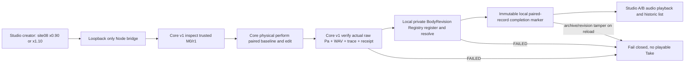

# CC-B1 Private Body Atelier — creator-first Gate D candidate

**2026-10-23 preregistered before implementation.** Draft-only local personal workflow, not a shipped public service. The owner delegates *scope engineering*; no mandate to build internet-hostile multitenant security, signatures, cloud identity, migration or an open-ended speech API. Core physical truth is still owned by Core, not the React or Node adapter.

## Decision and boundaries

The immediate deliverable is a private Studio surface where a creator chooses one Core-validated vocal tract rest-section-area ratio `0.90` or `1.10` at zero-based section 8, triggers real new fixed-task 1D Core source/tract simulation, and can play baseline and changed WAV side by side. The same immutable physical pair archive must reappear across browser/server restart. It is **not** the general graph editor, general sentence performance or natural Japanese voice.

Core fixed dependency [Draft #166](https://github.com/ryonakayama234/morphoacoustics/pull/166) HEAD `ef23738e1e6e3c631de5e36912bf5b601c7a17b3`, 13/13 checks success at inspection. It stacks on #165/#163/#159/#145 and is **not** on Core main. We must pin the precise commit and check that the source checkout is clean; **never use the older CC-A2 or X2a checkout** in its place.

## SYSTEM

**Physical authority:** source and gesture unchanged across A/B; Core independently solves both bodies; Studio must not synthesize, resample, tune gain between the pair, or invent physics. Display A and B's *common* WAV gain for comparative audition, not calibrated SPL. Show raw pressure/geometry metadata and exact Core SHA. A/B audibility and natural voice must be assessed by listening separately, not inferred from checksum difference.

## DATA

**Local bridge**, opt-in `npm run cc-b1:server`, `127.0.0.1:8767`; Vite development proxy `/cc-b1`. POST `/cc-b1/perform` accepts exactly `{"rest_area_ratio":"0.90"}` or `{"rest_area_ratio":"1.10"}`; no frontend-controlled parent digest, source, F0, output path, script, or numeric free range. GET `/cc-b1/health`, `/cc-b1/takes` and `/cc-b1/audio/:uuid/(baseline|edited)` are versioned local research endpoints. Stored pair record includes exact Core HEAD, schema, ratio, physical manifest with SHA, registry revision ID and core-verified body receipt. The physical source data, unmodified NPY/WAV/traces and their versioned manifest remain in the creator's local data directory. A record is only published after archive readback and Registry rederivation both agree. Historical reload re-verifies. Artifacts are allowlisted by filename, no arbitrary paths.

## EXPERIMENT — preregistered expected observations

| Case | Acceptance | Status |
|---|---|---|
| Only exact ratios 0.90/1.10 accepted; wrong schema/key/method refused | typed non-success without physical execution | NOT_RUN |
| Two ratio choices generate fresh true Core raw Pa, shared-gain playable WAV and physical trace | distinct source-verified revisions | NOT_RUN |
| Baseline and edited WAV from same physical pair, different pressure quantization | A/B side-by-side and download | NOT_RUN |
| Core archive marker absent or corrupt; fake body digest or wav mutation | nothing shown as completed | NOT_RUN |
| Registry tamper or restart replay mismatch | record withheld | NOT_RUN |
| Browser reload/server restart retains exact created pair, not latest preset | identical history | NOT_RUN |
| Source HEAD mismatch/dirty or wrong NumPy | fail closed before candidate success | NOT_RUN |
| Existing Studio X2a, CC-A2, v0/v1 CI unaffected | npm build/test and bridge policy | NOT_RUN |
| Windows/WSL2 human audition and subtle quality; human/ABX | future, not machine-certifiable | NOT_TESTED |
| Multiuser network attackers/hostile same-UID file race/kill -9 catastrophic durability | private workspace scope only | NOT_TESTED |

**Go criterion (personal-use candidate)**: authentic same-CI physical evidence, stable local operation, no false Takes on failures and no regressions. A narrow private experiment does **not** require public API packaging, cryptographic signatures, multiuser permissions or arbitrary body geometry. Keep Draft and do not merge without inspecting exact-head evidence and reviewing results. Specific implementation details left to engineering discretion.
