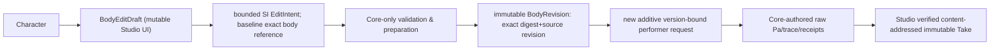

# CC-B1 — DATA / creator semantics proposal
**Not a released schema or authoritative Core geometry type.**

## Never conflate objects
- **Character**: name, appearance, identity and library choices; unchanged by audition.
- **BodyEditDraft**: editor-only mutable controls; may be invalid or undone; visual node positions are not physical units.
- **BodyRevision**: immutable *accepted and Core-authored* physical geometry/preparation with frozen exact ID/revision and digest. Studio cannot mint an accepted geometry hash by UI interpolation or guess the result of edited cross-section on its own.
- **Gesture/Direction**: the performance and transient intent, fixed for a causal geometry-only A/B. No editable effective pitch/F0, pressure, playback gain or arbitrary text in CC-B1.
- **Take**: immutable past request, exact body/preparation and source identity, raw Pa, listening WAV and artifact hashes; historical replay must not silently resolve the latest revision.

## Required UI statuses
- proposal validation: invalid / unsupported / prepared
- task realization: feasible / infeasible / unsupported
- solver: success / numerically unresolved / failed
- storage/playback: verified persistent Take / no Take
A rejected or unaudited proposal **never** appears as an authentic new physics Take.

Core [v1 contract](https://github.com/ryonakayama234/morphoacoustics/blob/main/docs/performance-contract-v1.md) supports exact **prevalidated preset IDs** only. Any new editable-body creation requires a separately versioned bridge design; don't mutate existing JSON v0/v1, trusted pin policy or old content-addressed files.

## Physical research observation handoff (not PerformanceResult schema)
Core PR #143 independently archives `pressure_0.90.npy`, `pressure_1.00.npy`, `pressure_1.10.npy`, and `preview_0.90.wav`, `preview_1.00.wav`, `preview_1.10.wav`, with exact per-file hashes, one common `comparison_shared_gain`, source/gesture hashes and limitation tags. These files are *proof-of-path research artifacts*, not mutable body preset records, published scientific acceptance, or Studio Takes. Future Studio trusted path must independently verify body revision, raw pressure bytes, WAV normalization, source identity and artifact hashes before saving any user Take. Never interpret per-file playback-normalization as a change of vocal effort.

## Exploratory Core spatial prelisten archive (not Studio data model)
One unchanged baseline and six ±10% local-rest-area interventions at section0/2/4 produce 7 SI-Pa NPY arrays, 7 identical-gain PCM16 listening WAVs and `decision.json` with strict section/area provenance, frozen source/task hashes, per-file SHA256, terminal F1/F2, raw waveform differences and exact solver count. [Archive #12342252192](https://github.com/ryonakayama234/morphoacoustics/actions/runs/39591507980/artifacts/12342252192), Core [PR #144](https://github.com/ryonakayama234/morphoacoustics/pull/144). This is NOT a BodyRevision API or published Studio Take. The research filenames reveal intervention identity and are therefore unsuitable as a supposedly blind randomized listening trial.
