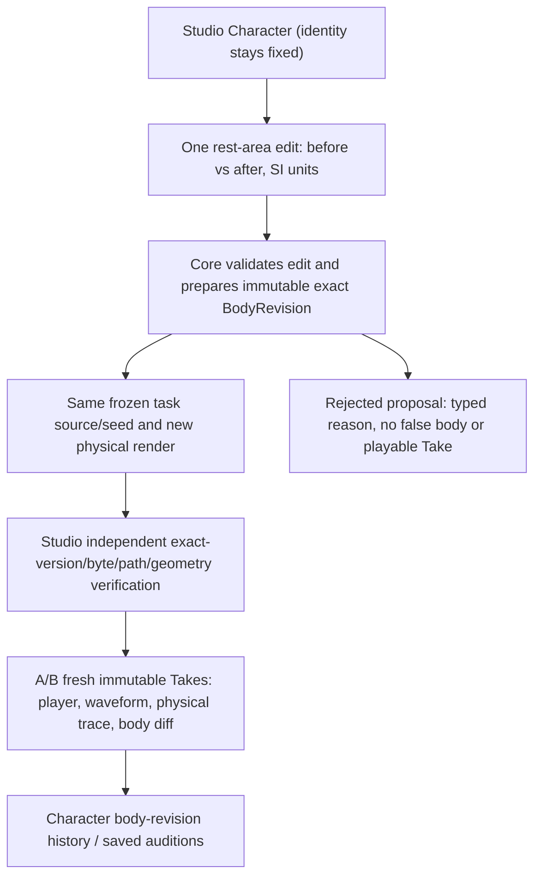

# CC-B1 — SYSTEM / Body Atelier creator journey
**Design-only; no claimed working editor.**



## UI sketch
```text
Character ── Body Atelier ──────────────────────────────────
[Reference body: exact ID@revision]  [limited 1D model]
Rest vocal-tract section [Core-enabled only]
before A_rest [m²]    after A_rest [m²]  (safe bounded input)
[Prepare validated body]    status: BOUND / explicit refusal
                    ↓
[Perform same frozen audition]     [Compare A | B]
body-geometry difference | source hash unchanged | waveform
[Save approved BodyRevision as Character option, not audio filter]
```

- Editable axis is **rest morphology**, not live gesture control. Do not accept user-friendly labels like “cute” or “female voice” as physical parameters. Show limits and uncertainty.
- A future anatomical node/edge canvas can reference the exact semantic vocal_tract organ, but do not imply a UI line is an adopted physical acoustic junction or that the active 1D source/filter has OG-4/OG-AUD1 branched source physics.
- Preserve adopted CC-A2/legacy X2a separate paths; use only a new adapter after Core Gate B+contract review. A/B playback normalization must not overwrite raw pressure.
- Record what is **heard**, not just the model's numerical peaks. Creators should be able to say “distinct, but still buzzer-like,” then return to the former body.

## Research sound preview source (not Studio integration)
The three standalone Core edited-body cases are now executed: `rest_area(section0) x {0.90,1.00,1.10}` with identical established three-task program and LF source. Core created raw Pa and three optional listening WAVs with **one shared playback gain** (no EQ, no post-hoc voice conversion). A Studio demo must use a **future exact-SHA trusted adapter after Core Gate A/B**, not consume research WAVs as though they were newly executed immutable Stage B Takes. Raw shape changes and audible quality remain distinct.

## Why waveform physical differentiation is not creator-voice differentiation
The creator reported inability to distinguish a section0 localized edit, even though raw pressure differed numerically. Human discernibility is an independent requirement: `BodyRevision->Gesture->physical sound` does not alone imply `audible new character`. The new Core post-hoc screening at zero-based sections2/4 adds audibility-reference files ONLY; Studio must not expose these pre-rendered samples as newly executed PerformanceResult, immutable Take, sound quality promises, or production presets. Audio quality/phonation and morphology/persona are distinct ongoing workstreams.

## Separate creator value from the physics proof
The *narrow research engine* already generates new raw pressure under new 1D rest shapes; it is not a callable native Character Creator shape editor. `s04_110` did **not** turn on a new motor gesture or previously inactive organ: the edited 10%-wider rest section is already affected by the frozen task-field movement. What creators must eventually do themselves: choose/edit a bounded **physical rest anatomy field**, observe SI/body diff and explicit accepted capability, execute the same performance through trusted Core, compare new audio, save a versioned body and two immutable Takes, recover them unchanged after reload, and reject failed/tampered inputs. That is the phase-B creator-action completion condition; a ZIP of research WAVs alone is not.
