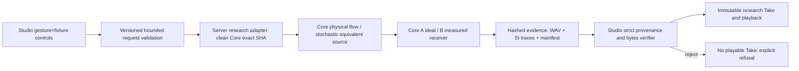

# NV1-EAR / Studio — creator SYSTEM

## Purpose
Let a creator select one restricted bodily exhalation drive, press **Perform**, and hear an actual freshly generated breath-like research Take at a measured near-field receiver position. The UI controls **body actuation and listener fixture, not spectrum, pitch, breath WAV, arbitrary source gain, or voice quality**.

## Research-only creator journey
1. Choose preset **P0** (120 Pa / 30 mm²), **P2** (240 Pa / 30 mm²), or **A2** (120 Pa / 60 mm²); same seed `133041` initially. Display research-only `EXHALE`, not public GestureScore enum.
2. Choose center / left / right **measured near ~0.30m** SOFA target; label actual measured azimuth returned by Core; no 1 cm slider or extrapolated free pose.
3. Choose receiver A ideal two point probes (modeled SI Pa before playback) or B measured SOFA (relative units only).
4. Click Perform => actually execute exact-SHA pinned *separate clean Core NV1 checkout* via server research adapter => verify complete manifest + WAV + traces => persist immutable **research Take**, then make it playable. Missing runner/data/unsafe path/hash => refusal with **no** playable Take.
5. Compare physical variant P0 vs P2/A2 with same seed/direction/receiver; separately compare receiver A vs B for **identical source hash**. Offer blind headphone A/B, reveal labels afterward. Prompt separate scores/comments for air-likeness, timbre, proximity/externalization, lateralization and naturalness. No composite ASMR score.
6. Reload and restart: persisted research Take resumes playback and metadata; never fabricate new physical run from old audio.

## Ownership / typed diagram
Studio displays (read-only) `RespiratoryDrive -> EffectiveAperture -> JetState -> TurbulenceEquivalentSource -> MouthAcousticSource -> Listener L/R` with typed Pa, m², m³/s, m/s, fluctuation m³/s, acoustic Pa or relative transfer units. Later laryngeal phonation and tract/oral constriction branches can be connected, but **not simulated and not enabled now**. Do not express breathiness by simply post-adding Studio noise.

Core physical runner owns source, receiver, SI, sample rate, errors, calibration claims. Adapter owns validated data conversion and process sandbox/provenance. Studio owns intent, UI, blind labels and artifact storage; never reinterpret physical results.

## Safety and execution
- Research route/name namespace distinct from production. Require exact trusted Core SHA and clean working tree; no auto fallback to any current local Core executable. Source SHA must reference actual implementation, **not the current docs-only SHA**.
- Avoid shell string interpolation; use fixed executable path/argv and controlled working dir, allowlisted args, resource/time/output caps, exclusive temp dirs, verified canonical paths. Reject symlinks/path traversal, unexpected file extensions, bad JSON shape, stale hashes, unsigned/unexpected source provenance and missing SOFA hash. These are implementation goals, not claims current Studio already implements them.
- Never load arbitrary SOFA from creator upload; trusted manifest/download fixture only, hashes pinned. No measured-B calibration claim; never independently normalize L/R.
- Stable Take status types: `PENDING`, `FEASIBLE`, `INVALID`, `UNSUPPORTED`, `INFEASIBLE`. Failure shows error and records no playable Take.

## Exclusion
No new full Character Creator organ editor; no arbitrary curves, full phonation, /ha/ or /fu/ synthesis, online low latency, free head rotation, wet contact, direct browser execution of Python, source waveform authoring, public Contract v1 edits, or main merge.
