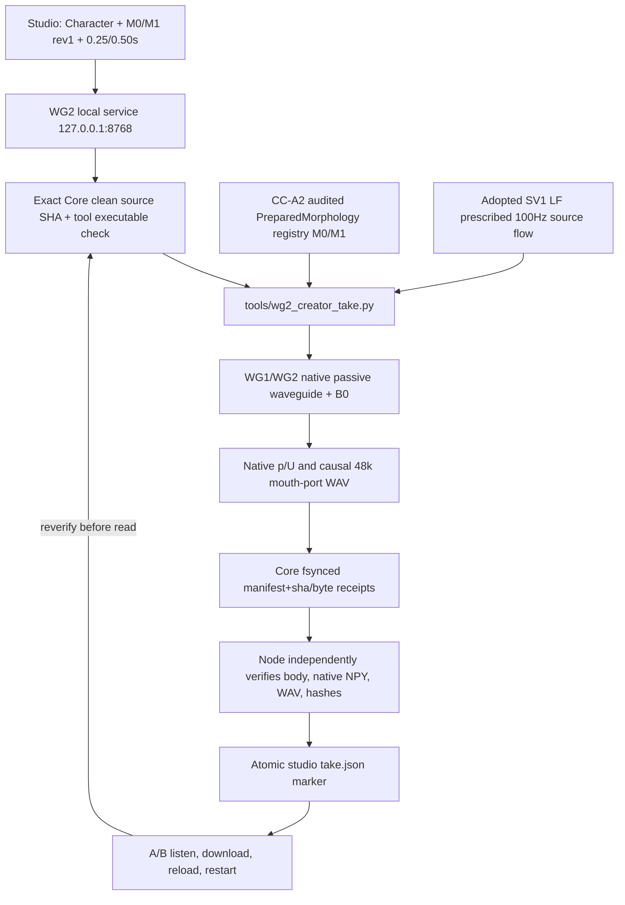

# WG2 Studio system — new acoustic physical Take (experimental)

The Core script is the *only* generator of physical pressure and WAV. Node does not synthesize or normalize. UI uses no unconstrained Script/Direction; only one static /a/-like 100Hz externally prescribed motor/source flow. This is not the old CC-A2 dynamic /ai/, not human-like speaker identity or microphone output. No main backend replacement.

Strict boundaries: Core older X2a/CC-A2 histories remain frozen, new WG2 data root and local port unique, new history only post-validated Take, and source SHA pinned to one exact reviewed Core checkout. Browser reload or server restart loads only previously valid immutable marker; SHA and source verification is repeated before playback.
