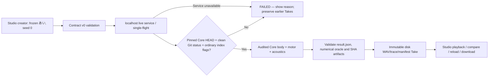
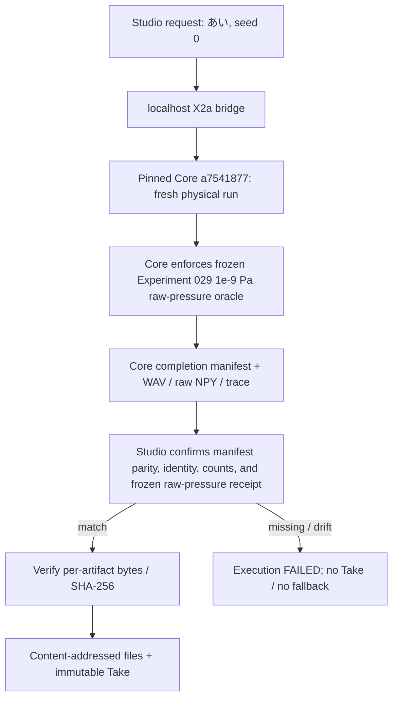

# X2a — First Live Embodied Take

Status: Draft PR #15; numerical CI and human playback gates are required before merge.

## Scope and model evidence

Studio converts exactly one creator Script segment あい into the already audited
Core experimental /a/→/i/-like continuous motor plan. Core revision is fixed at
a75418770ed28cbd301d554171a6b60ee5a05ee9 (Core Issue #69 / PR #70).
This is ONE physical body, ONE frozen pronunciation, seed 0, no validated creative
Direction, not arbitrary Japanese TTS. Human vowel identification is not certified.

Live X2a calls a new physics computation and returns 0.5 seconds / 48 kHz /
24,000 mono WAV samples, raw pressure in Pa, selected 10-ms-aligned physical trace,
diagnostics and manifest. Playback WAV is normalized to peak 0.90: it is not
a quantitative SPL measurement. Physically unreachable body M_minus is NOT
exposed as a selectable body; the scientific Core test keeps that gate separate.

## Architecture and safety

- Studio owns the Character, Script, Direction, Take and display.
- Only Core owns PreparedMorphology, task/motor physics and acoustics.
- The pinned creative v0 contract stays authoritative at Core and the vendored
  v0 snapshot is read-only in Studio.
- The new Node localhost service binds to 127.0.0.1:8765 and Vite proxies /live.
  It accepts validated JSON, never launches user-selected commands, and uses a
  fixed Python entrypoint with an exact audited Core git commit check.
  Before service startup and every fresh physical run, the bridge rejects any
  modified/deleted tracked or untracked non-ignored Core files; it checks again
  after the Python subprocess exits, before accepting a successful Take. This
  is a fail-closed local reproducibility guard, not a hardened filesystem sandbox.
  Core's ignored virtual environments, Python caches and build outputs are allowed.
- Experimental live mode explicitly disables the unsupported Direction controls.
  No energy/pace/emotion/notes are quietly turned into uncalibrated physics.
- The Core completion marker result.json and each SHA-256/byte-size check must
  pass before WAV, raw NPY and trace CSV are copied into a disk-persistent,
  content-addressed artifact store. Take metadata is also saved server-side.
- A previous Take cannot be silently recycled as a success after an invalid,
  unsupported, physically infeasible, interrupted, or failing run. Job FAILED
  and realization outcomes UNSUPPORTED / INVALID / INFEASIBLE stay distinct.
- Generated files live under .morpho-live-data/ in Studio, excluded from Git.
  Browser localStorage only stores a Take index; it never holds the generated
  WAV bytes. Deleting an item in the UI does not currently garbage-collect
  disk artifacts.

## WSL2 / Linux runbook

Requirements: Node.js >=22.12, npm, Python >=3.11, Git. Clone the two
repositories as sibling directories in WSL2. Run the following in one terminal:

```bash
git clone https://github.com/ryonakayama234/morphoacoustics.git
cd morphoacoustics
git checkout a75418770ed28cbd301d554171a6b60ee5a05ee9
python3 -m venv .venv
source .venv/bin/activate
python -m pip install 'numpy==2.4.6'
python -m pip install -e '.[dev]'
cd ..

git clone https://github.com/ryonakayama234/morphoacoustics-studio.git
cd morphoacoustics-studio
git fetch origin pull/15/head:x2a-live
git switch x2a-live
npm install
export MORPHO_CORE_DIR="$(pwd)/../morphoacoustics"
export MORPHO_PYTHON="$(pwd)/../morphoacoustics/.venv/bin/python"
npm run live:server
```

From a second terminal in the Studio checkout:

```bash
npm run dev
```

Open the Vite URL (localhost port 5173 by default), choose Live Experimental,
click the demo button for あい + seed=0, then Perform. Listen, download,
reload and listen again. Do not label the generated sound natural Japanese.

## Automated real-browser CI (Linux Chromium)

The pull-request integration workflow now has an **additional** headless Chromium
smoke after its frozen two-run Core/Node integration. The test
`server/live-browser-smoke.mjs` starts its own audited Core-backed localhost
service and Vite UI, performs the supported 「あい」 request via the actual
React buttons, asserts browser-decodable 0.5-second WAV and content SHA-256,
reloads the page, fetches the saved physical-trace CSV, restarts the Node
service, reloads again and verifies the exact original WAV bytes. It also
submits the unsupported 「ありがとう」 and asserts no second playback WAV;
the first accepted Take is left intact. The workflow uploads a browser
screenshot, server logs and persisted Takes as review evidence.

CI installs Chromium/Playwright **ephemerally** with `npm install --no-save
--no-package-lock playwright@1.55.0`; no application dependency or frozen Core
code is introduced. Browser playback testing verifies decoding and timeline
progression, not actual sound through a Windows headphone. This automated
Ubuntu browser gate is **not a substitute** for the still-required manual
Windows/WSL2 localhost browser smoke, human listening, independent security
review, or scientific claim review. A CI failure leaves PR #15 Draft.

## Gates before completing Issue #11

1. Studio npm test / npm run test:bridge / npm run build pass.
2. GitHub physical CI checks out the exact Core SHA, runs with NumPy 2.4.6,
   launches two fresh physical executions and verifies 102 acoustic transfer
   calls per run, 24,000 WAV samples, immutable unique Take IDs,
   SHA-matching audio/trace, raw-pressure quantized scientific signature,
   and no-fallback for an unsupported new script.
3. Automated Ubuntu Chromium end-to-end browser smoke plus manual WSL2 Perform -> WAV -> reload -> replay and server restart persistence.
4. Separate code-security/transport review and scientific-claim review.
5. Provenance regression tests reject modified tracked Python source, newly
   untracked Python source, a wrong commit, and edits after service startup.
   Those tests are run via `npm run test:bridge`; passing them does not waive
   the manual Windows/WSL2 UI check or separate reviewer signoff.

Wolfram independently checked 0.5 * 48000 = 24000 samples and 10-ms frames
corresponding to 480 samples. This is only timeline arithmetic, not physical
validation of the acoustic synthesis.

No promise is made of adjustable vocal effort, emotion, vowel recognition,
general phonology, 3D anatomy, FSI, or two-body live comparison. These belong
to later, separately gated work.

References:
- https://github.com/ryonakayama234/morphoacoustics/blob/a75418770ed28cbd301d554171a6b60ee5a05ee9/docs/limited-live-physics-x2a.md
- https://github.com/ryonakayama234/morphoacoustics-studio/issues/11
- https://github.com/ryonakayama234/morphoacoustics/issues/69

## 2026-10-17 release-readiness checkpoint

**Review basis (not a release approval):** Studio PR #15 HEAD
`debbe2d883d5f2f1a1ad2f1d6804f7d71bb21750`, Studio main
`e28edeb2e59eed549801392eaf2f193a43d3e67a`, pinned Core
`a75418770ed28cbd301d554171a6b60ee5a05ee9`.

This checkpoint was prepared from the exact pinned GitHub source, PR reviews,
documented CI results, and a fresh Wolfram arithmetic evaluation. It did **not**
execute the Studio UI in a Windows/WSL2 environment and is **not** a substitute
for independent code/security or scientific review.

### Evidence already available at the reviewed HEAD

- [Studio CI](https://github.com/ryonakayama234/morphoacoustics-studio/actions/runs/38128855947) — success.
- [Pinned Core/Node plus Linux Chromium physical/browser CI](https://github.com/ryonakayama234/morphoacoustics-studio/actions/runs/38128855905) — success; includes fresh physical runs, WAV/trace persistence, unsupported-input no-fallback, and browser decode/reload/restart.
- [Earlier provenance-hardening receipt](https://github.com/ryonakayama234/morphoacoustics-studio/pull/15#issuecomment-6083767353) — tracked/untracked Core changes rejected, with direct regression evidence.
- Independent Wolfram evaluation on 2026-10-17:
  `48000 * (1/2) == 24000` samples;
  `48000 * (1/100) == 480` samples/10 ms;
  50 intervals across 0.5 s, with 51 grid points including both endpoints.
  Two calls times 51 equals 102 **arithmetically**, but acoustic calls must
  still be substantiated by the actual Core execution manifest and CI logs.
  The final point has sample index 24000 and is an endpoint-exclusive
  boundary, not a 24001st waveform sample. This establishes timeline
  consistency only, **not** speech correctness, voice likeness, FSI, or
  a new acoustics/biomechanics validation.

### Outstanding blocking acceptance evidence

- [ ] **Windows/WSL2 manual creator smoke:** follow the runbook above with
  the pinned Core and the exact PR HEAD. Record Windows version, WSL
  distribution, Node/Python/NumPy versions, Git SHA, network host/ports and
  browser. Perform the frozen 「あい」 demo, listen to actual playback,
  download WAV, reload, replay the exact persisted bytes, restart the localhost
  service, replay again; confirm unsupported 「ありがとう」 has **no new WAV**.
  Record an evidence log/attachment and the WAV SHA-256, without substituting
  a Linux Chromium-only result or a previous informal WAV listening session.
- [ ] **Independent transport/security/API signoff:** separate reviewer
  inspects current exact HEAD, single-flight admission prior to async body
  reading, bounded upload, origin/localhost policy, fixed child invocation,
  tracked/untracked Core revision pre/post checks, symlink/path and artifact
  digest handling, HTTP response failure semantics, persistence after restart,
  and locally trusted dependency/threat-model limits. Comment with evidence,
  any remaining risks, and explicit disposition.
- [ ] **Independent scientific/contract/provenance signoff:** separate reviewer
  verifies pinned Core manifest, NumPy 2.4.6, two fresh 102-transfer runs,
  quantized raw-pressure fixture vs playback-normalized PCM, source/body/task
  identity, v0 request/result mapping, distinct unsupported vs infeasible vs
  failed meanings, preservation of prior Takes, and explicitly bounded
  /a/-like→/i/-like claim. One person's informal listening does not constitute
  a blinded phonetic gate. Comment with explicit disposition.
- [ ] Resolve all blockers found in those checks, rerun tests on the resulting
  exact HEAD, confirm both reviews apply to that HEAD, then perform adoption
  and post-merge main smoke **only after all gates are fulfilled**.

### Responsibility / disposition

Studio owns transport, creator request, playback and immutable artifact
persistence; Core owns prepared body, physical realization and acoustics.
Performance Contract v0 remains upstream-owned. No new physics, body selector,
emotion mapping or WAV post-hoc correction is introduced in X2a.
Code/design changes, if actually required, must update the relevant
architecture/data/execution notes in the same PR. An unchanged successful
CI report is historical execution evidence, not proof of a current Windows
manual test. **Decision at this checkpoint: HOLD DRAFT; no merge or issue close.**

## 2026-10-17 implementation continuation: index-flag provenance and outage UX

A local falsification test demonstrated that `git status --porcelain` can report
a clean tree after a tracked Python solver file is modified while Git's
`assume-unchanged` or `skip-worktree` index flag is set. The original
Core HEAD-and-status check would therefore accept a falsely clean solver.
The updated `verifyCoreRevision` rejects nonordinary tracked index
entries (`git ls-files -v -z`) as well as dirty or untracked files.
This is a stricter reproducibility policy: sparse/skip-worktree Core
checkouts must be normalized before use. It still does not provide
atomic isolation against a malicious concurrent filesystem writer.

Two Node policy regressions recreate the original false-clean behavior
and verify rejection. The browser smoke now also stops the local service
after the accepted Take/reload/restart and unsupported-input tests,
checks that a new Perform shows a meaningful `Live X2a` failure,
and ensures that neither a new false Take nor loss of the prior Take
occurs. Studio unwraps the existing `BackendExecutionError` for
actionable creator-facing transport diagnostics; its contract and
failure semantics are unchanged.

### Updated data/decision flow



Review gate remains **open**: update the exact-head CI evidence after
this change; independent code-security and scientific signoff and
manual Windows/WSL2 playback remain required. No change to Core physics,
the one-body experimental claim, or acceptance of additional Direction.

## 2026-10-18 Windows/WSL2 user acceptance — first physical Take and A/B correction

The user successfully completed Windows/WSL2 Ubuntu setup with clean frozen Core
`a75418770ed28cbd301d554171a6b60ee5a05ee9`, NumPy 2.4.6, and an exact
Studio X2a checkout at `cf4457f1fa477eac899738b94428aa2a95451072`.
The localhost Node bridge and Vite UI launched; user screenshots show Windows
browser access, the one-segment `あい`/seed=0 fixture, **one newly generated
`SUCCEEDED / FEASIBLE` Live X2a Take**, and an audio control and WAV download
link. The user also reports that generating, deleting, and generating another
Take succeeded. This is user-supplied functional evidence; **actual human
listening, downloaded WAV hash, reload/replay and server restart/replay are
not yet recorded** and must not be inferred from screenshots. The locally
running checkout remains at that older Studio SHA until deliberately updated.

The user identified a comparison UX defect: for a single Take, clicking B
after A highlighted both, and repeated clicks seemed inert. The original
independent `compareA`/`compareB` state allowed the same Take ID in both
slots. A/B are **different Take comparison slots**, not player playback
controls or validated different vocal performances.

The correction on this same Draft PR gives the A/B selection a single
exclusive state object: assigning a Take to the other slot moves it, clicking
an assigned slot again clears it, a second distinct Take may be compared,
and deletion vacates only that Take's slot. Accessible `aria-pressed`
identifies the selected button. The comparison panel explains that different
Takes are required. New Vitest policy tests and the actual Chromium
physical-Take browser smoke cover the regression. No physical Core model,
source, frozen mapping, contract, artifact, or saved WAV changes were made.

**Gate separation:** UI bug fix and automated checks do not substitute for
actual Windows audio playback, hash/reload/restart evidence, independent
code-security review, or independent scientific/contract review. Keep PR
Draft and Issue #11 open; do not merge until the existing gates pass.

## 2026-10-19 final-gate continuation — raw-pressure oracle fail-closed repair (PR #15)

**Scope:** resolve [Codex exact-HEAD P1 raw-pressure finding](https://github.com/ryonakayama234/morphoacoustics-studio/pull/15#discussion_r4309323560) without changing audited Core `a75418770ed28cbd301d554171a6b60ee5a05ee9`, the creative v0 contract, the single-body/single-`あい` capability, or source/geometry/phonetic claims.

### Causal/data path and refusal gate



Core already computes and checks the Experiment-029 quantized signature before it publishes its result. The Studio bridge now separately rejects a `FEASIBLE` result unless `provenance.quantized_raw_pressure_sha256` exactly equals `dc14c78bcc6d4a19c11fe2a01ba84b1394802b66626f4dfa27cc582c741e714e` at `quantization_pa=1e-9`, along with the expected source, body, pronunciation, seed, sample count, rate and transfer count, **before** artifact copying or Take persistence. The previous unguarded path could have accepted a structurally valid but numerically drifted Core receipt. A mismatch now fails the creator execution rather than being recorded as a successful physical result.

This checks Core's scientific receipt at the Studio trust boundary; it is **not** an independently recomputed waveform oracle. The existing Core source-pinning, quantized numerical preflight, and byte-SHA-256 checks remain separately necessary. The raw-pressure signature is **not** the peak-normalized listening WAV's digest, amplitude, SPL, or a perceptual gate. The existing test suite is extended with valid, missing, drifted, mismatched-quantization, source/body/pronunciation and transfer-count cases.

### Existing manual acceptance evidence reused (no unnecessary repetition)

The creator has already confirmed on Windows/WSL2:
- fresh pinned physical Take generation and listening to experimental `あい`;
- reload/replay and localhost service restart/replay;
- corrected A/B switching on the exact original PR HEAD `244a29d`;
- independent byte inspection of downloaded WAV and physical trace CSV (see PR #15 receipt `6256706776`).

These verify creator usability, **not** the qualification of the physical model or a blinded phonetic identification. Unrelated manual tests are not repeated solely due to this manifest-only check; run exact-head automated integration and independent review.

### Mandatory acceptance gates and stopping rule

- [ ] Exact repair HEAD: Node policy tests, Studio test/build, pinned physical integration, Linux Chromium E2E — links and conclusions must be recorded.
- [ ] Independent exact-repair-HEAD software/security/API review with substantive disposition, including this numeric refusal gate and evidence handling.
- [ ] Independent scientific/contract/provenance review by a separate qualified reviewer, explicitly distinguishing narrow adopted computational claims from user-reported auditory perception.
- [ ] Only after both independent reviews and green exact-head CI: explicit `GO_LIMITED` decision, reviewed squash merge to main, post-merge verification, then Issue #11 closure.

If a credible separate scientific reviewer is unavailable, remain **HOLD / Draft / unmerged**. Approval must not be fabricated by the implementer. Keep Core and user Take storage unchanged, and preserve all existing immutable evidence.

## 2026-10-19 security and bounded science review continuation

Independent Codex code review on `7d3be7f` found an executable-import bypass:
an ignored `src/sitecustomize.py` can escape `git status` while executing at
Python startup. The bridge now rejects ignored executable source under
Core `src/`, `experiments/` and relevant root startup paths even when hidden by
tracked `.gitignore`, `.git/info/exclude`, or a global excludes file.
Each Core child also gets a fresh, isolated `PYTHONPYCACHEPREFIX`, preventing
previously ignored `__pycache__` bytecode from being loaded in preference to
audited source. Existing virtual environments are otherwise trusted local
dependencies, not certified against malicious environment installation.
Negative policy tests reproduce each false-clean Git case.

For an independent *numerical* cross-check, Studio now parses
`raw_pressure_pa.npy` as a 24,000-element little-endian float64 vector,
applies the frozen 1e-9 Pa quantization with nearest-even int64 rounding in
Node.js, and requires the exact Experiment-029 SHA-256 **before any Take or
artifact persistence**. This examines emitted raw bytes, not merely Core's
self-reported provenance. The algorithm has synthetic ties-to-even, invalid NPY
and tamper regressions, plus a genuine Core WAV/NPY/CSV integration smoke.
The original Core science threshold is unchanged.

The source-led [AI-assisted science, contract and provenance audit](x2a-scientific-contract-audit.md)
records the exact upstream experiment claims, five byte-identical v0 schemas,
data/causality boundary, 102 physical transfers, 51 trace endpoints, raw/WAV
separation and all unverified human-phonetic claims. **Its reviewer is the
implementation agent; it is not an independent external scientific peer review.**
The user's delegation permits an evidence-based ChatGPT technical audit as the
practical local release standard. A separate independent Codex security/code
finding must still be resolved before `GO_LIMITED` and squash merge.
